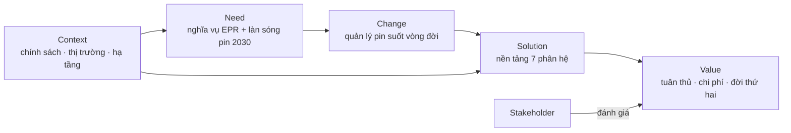

# S2 — BACCM

Mô hình 6 khái niệm lõi của BABOK v3 áp vào dự án.

| Khái niệm | Câu hỏi | Trả lời cho Battery 2030 |
|---|---|---|
| **Change** (thay đổi) | Cái gì thay đổi? | VELIX chuyển từ "bán xong là hết trách nhiệm" sang quản lý pin suốt vòng đời: định danh khi bán, thu hồi khi hết hạn, quyết định đời thứ hai hay tái chế, báo cáo EPR có số liệu gốc. |
| **Need** (nhu cầu) | Vì sao phải thay đổi? | (1) Ắc quy chì có nghĩa vụ 12% từ năm 2026 (REQ-VN-15). (2) Pin Li xe điện có mốc điều chỉnh tỷ lệ năm 2029 (REQ-VN-11). (3) Làn sóng pin Li hết hạn tăng mạnh sau 2030 (S9). (4) Pin vào khu vực phi chính thức gây rủi ro cháy nổ và ô nhiễm (SRC-020). |
| **Solution** (giải pháp) | Cái gì đáp ứng nhu cầu? | Nền tảng 7 phân hệ (MOD-REG, COL, SOH, RTE, EPR, PSP, PTN) + quy trình thu hồi To-Be + phương án tài chính được chọn bằng business case. |
| **Stakeholder** (bên liên quan) | Ai bị ảnh hưởng hoặc có quyền quyết định? | VELIX (ban điều hành, tuân thủ, dịch vụ), đại lý, trạm đổi pin, người dùng xe, đơn vị tái chế có phép, đơn vị đời thứ hai, PRO, Bộ NN&MT, Quỹ BVMT VN, thu gom phi chính thức. Chi tiết: S4. |
| **Value** (giá trị) | Mỗi bên được gì? | VELIX: tuân thủ đúng hạn, chọn phương án rẻ nhất, doanh thu từ pin đời thứ hai. Người dùng: trả pin miễn phí, an toàn. Đơn vị tái chế: nguồn pin ổn định, có chứng từ. Cơ quan quản lý: số liệu có căn cứ. Xã hội: giảm pin vào kênh không an toàn. |
| **Context** (bối cảnh) | Điều kiện xung quanh? | Hà Nội hạn chế xe máy xăng trong Vành đai 1 từ 01/7/2026 (SRC-017); xe máy điện VN ~735 nghìn xe năm 2025 (SRC-011, Unverified); ~60% xe máy điện bán mỗi năm dùng ắc quy chì (SRC-020); chưa có công suất tái chế pin Li công bố (ASM-12); EU bắt buộc battery passport từ 18/2/2027 (REQ-EU-20). |

## Liên kết giữa các khái niệm

