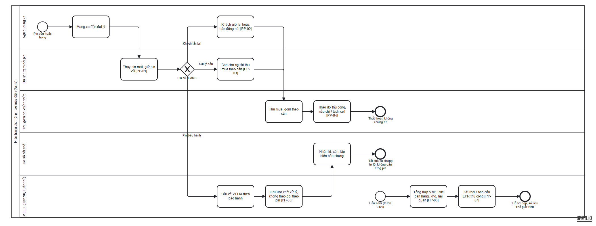

# S7 — Quy trình hiện tại (As-Is)

Nguồn BPMN: [as-is.bpmn](as-is.bpmn) (sinh bằng [build_as_is.py](build_as_is.py)). Ảnh:

Quy trình dựng từ phỏng vấn giả lập INT-01 – INT-03 ([elicitation.md](../elicitation.md)) và báo chí ngành (SRC-010, SRC-020).

## 1. Luồng

1. Pin yếu hoặc hỏng → người dùng mang xe đến đại lý.
2. Đại lý thay pin mới và giữ pin cũ. Pin cũ đi theo một trong ba nhánh:
   - **Khách lấy lại** rồi giữ ở nhà hoặc bán đồng nát.
   - **Đại lý bán** cho người thu mua theo cân.
   - **Pin còn bảo hành** gửi về VELIX, lưu kho, sau đó bán theo lô cho cơ sở tái chế.
3. Hai nhánh đầu đi vào khu vực phi chính thức: tháo dỡ thủ công, nấu chì hoặc tách cell, không có chứng từ.
4. Đầu năm, phòng Tuân thủ tổng hợp khối lượng đưa ra thị trường từ ba file, rồi kê khai hoặc báo cáo EPR thủ công.

## 2. Điểm đau

| Mã | Điểm đau | Hệ quả | Nguyên nhân gốc (xem [root-cause.md](../root-cause.md)) | Nhu cầu |
|---|---|---|---|---|
| PP-01 | Đại lý giữ pin cũ, không có quy định tiếp nhận | Pin lưu chứa không an toàn trong xưởng | RC-2 | NEED-03, NEED-04 |
| PP-02 | Khách giữ lại hoặc bán đồng nát | Pin rời khỏi tầm kiểm soát | RC-3 | NEED-12 |
| PP-03 | Đại lý bán pin cho người thu mua | Thất thoát; không tính được vào kết quả tái chế | RC-3 | NEED-03 |
| PP-04 | Tháo dỡ thủ công, nấu chì | Ô nhiễm, cháy nổ (SRC-020) | RC-3 | NEED-08 |
| PP-05 | Kho VELIX không theo dõi theo từng pin | Không chứng minh được khối lượng thu hồi | RC-1 | NEED-02, NEED-07 |
| PP-06 | V tổng hợp từ 3 file lệch nhau | Rủi ro sai số khi đối chiếu thuế/hải quan (REQ-VN-30) | RC-1 | NEED-01 |
| PP-07 | Kê khai/báo cáo thủ công | Trễ hạn, sai công thức F = R × V × Fs | RC-4 | NEED-09 |

## 3. Số đo hiện trạng (ước lượng)

| Chỉ số | Giá trị | Căn cứ |
|---|---|---|
| Pin có mã định danh theo dõi được | 0% | INT-01 *[giả định]* |
| Pin Li thu hồi qua kênh chính thức (toàn quốc) | 5–20% | ASM-11 (khoảng, không quan sát được) |
| Thời gian tổng hợp số liệu EPR | Nhiều ngày công/năm | INT-01 *[giả định]* |
