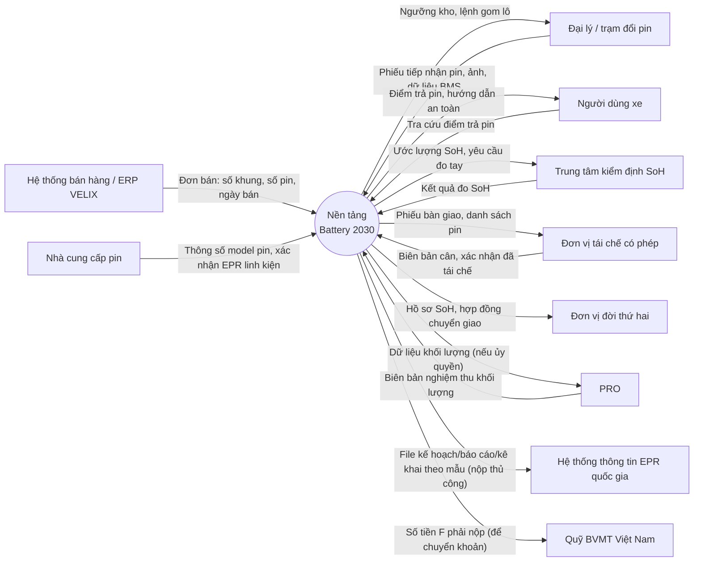

# Context diagram (mức 0)

Hệ thống: **Nền tảng Battery 2030 của VELIX** (gọi tắt: nền tảng).

| Thực thể ngoài | Hướng | Dữ liệu | Tần suất |
|---|---|---|---|
| ERP VELIX | Vào | Đơn bán, số pin gắn xe, pin bán thay thế | Hằng ngày (batch) |
| Nhà cung cấp pin | Vào | Thông số model, mã hóa học, khối lượng, xác nhận EPR linh kiện (REQ-VN-10) | Khi có model mới |
| Đại lý / trạm đổi pin | Hai chiều | Phiếu tiếp nhận; lệnh gom lô | Mỗi lần tiếp nhận |
| Người dùng | Hai chiều | Tra cứu điểm trả, hướng dẫn | Theo nhu cầu |
| Trung tâm kiểm định | Hai chiều | Ước lượng SoH; kết quả đo | Mỗi pin |
| Đơn vị tái chế | Hai chiều | Phiếu bàn giao; biên bản cân; xác nhận đã tái chế | Mỗi lô |
| Đơn vị đời thứ hai | Ra | Hồ sơ SoH, hợp đồng chuyển giao (REQ-EU-15) | Mỗi lô |
| PRO | Hai chiều | Dữ liệu khối lượng; nghiệm thu (REQ-VN-20) | Hằng quý |
| Hệ thống EPR quốc gia | Ra | File theo mẫu; nộp thủ công vì chưa có API công bố | Hằng năm, trước 01/4 |
| Quỹ BVMT VN | Ra | Số tiền F | Hằng năm, trước 20/4 |
