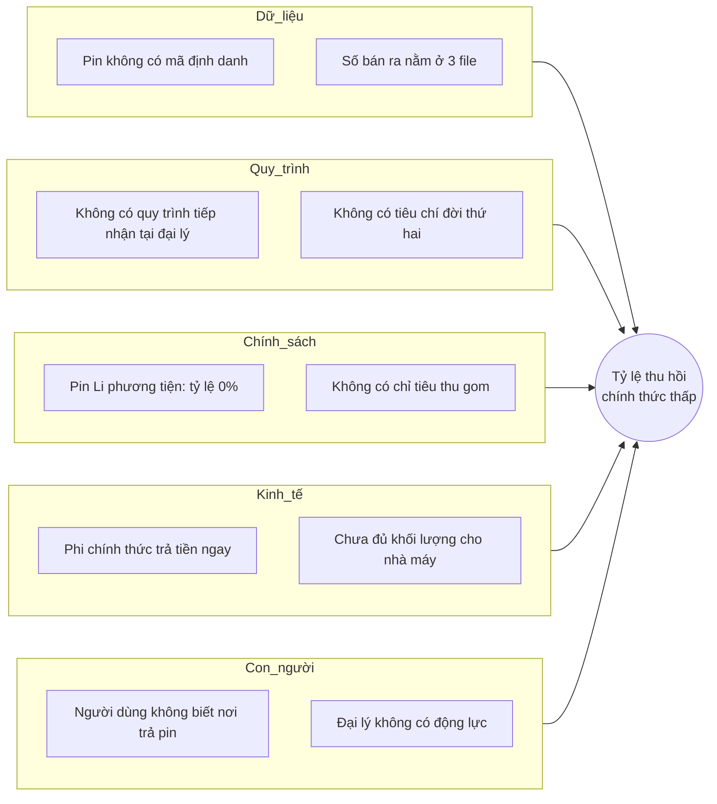

# Phân tích nguyên nhân gốc — tỷ lệ thu hồi pin chính thức thấp

## 1. Sơ đồ xương cá

## 2. 5 Whys

| Bước | Câu hỏi | Trả lời | Căn cứ |
|---|---|---|---|
| 1 | Vì sao VELIX không biết pin cũ đi đâu? | Pin rời đại lý không qua bước ghi nhận nào | PP-01, PP-03 |
| 2 | Vì sao không ghi nhận? | Không có mã định danh pin và không có quy trình tiếp nhận | PP-05 |
| 3 | Vì sao chưa có? | Chưa có nghĩa vụ định lượng với pin Li (0%) nên chưa ai đầu tư | REQ-VN-16 |
| 4 | Vì sao vẫn cần làm ngay? | Ắc quy chì đã có 12%; pin Li có mốc điều chỉnh 2029; làn sóng pin Li hết hạn tăng mạnh sau 2030 | REQ-VN-15, REQ-VN-11, S9 |
| 5 | Gốc rễ? | Thiếu dữ liệu vòng đời ở cấp từng pin — không có nó thì mọi phương án (tự làm, đóng quỹ, PRO) đều thiếu căn cứ | — |

## 3. Nguyên nhân gốc và cách xử lý

| Mã | Nguyên nhân gốc | Xử lý | Phân hệ |
|---|---|---|---|
| RC-1 | Không có dữ liệu ở cấp từng pin | Định danh pin khi bán; tổng hợp V tự động | MOD-REG, MOD-EPR |
| RC-2 | Không có quy trình tiếp nhận và lưu chứa tại điểm thu | Quy trình tiếp nhận chuẩn, checklist an toàn, ngưỡng gom lô | MOD-COL |
| RC-3 | Kênh chính thức kém hấp dẫn hơn kênh phi chính thức | Nhận miễn phí mọi hãng; ưu đãi khi trả pin; cổng tra cứu điểm trả | MOD-COL; business case |
| RC-4 | Báo cáo EPR làm tay, tham số không quản lý | Bảng tham số R, Fs, hạn theo năm; tính F tự động | MOD-EPR |
| RC-5 | Không có tiêu chí đời thứ hai | Quy tắc điều phối dựa trên SoH có người duyệt | MOD-SOH, MOD-RTE |

Chú ý: RC-5 tách khỏi sơ đồ xương cá ở nhánh *Quy trình* (Q2).
