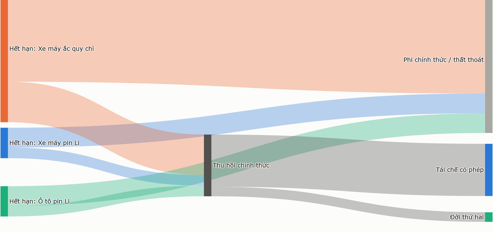

# S10 — Phân tích dòng vật chất năm 2030

Trang tương tác (chọn kịch bản, rê chuột xem số): [outputs/mfa-sankey.html](outputs/mfa-sankey.html). Ảnh kịch bản Cơ sở:

## 1. Dòng chính — kịch bản Cơ sở, giá trị likely (nghìn tấn)

| Bước | Xe máy pin Li | Xe máy ắc quy chì | Ô tô pin Li | Tổng |
|---|---|---|---|---|
| Đưa ra thị trường (mới + thay thế) | 21,4 | 34,8 | 103,4 | 159,5 |
| Đang lưu hành cuối năm (triệu pin) | — | — | — | 9,3 |
| Hết hạn | 6,8 | 33,0 | 6,8 | 46,5 |
| → Thu hồi chính thức | 2,4 | 9,1 | 2,4 | 13,8 (30%) |
| → Phi chính thức / thất thoát | 4,4 | 23,9 | 4,4 | 32,7 (70%) |
| Thu hồi chính thức → Đời thứ hai | 0,8 | 0 | 1,3 | 2,1 |
| Thu hồi chính thức → Tái chế có phép | 1,6 | 9,1 | 1,1 | 11,7 |

Nguồn: [sankey_2030.json](outputs/sankey_2030.json), [eol_likely.csv](outputs/eol_likely.csv).

## 2. Tỷ lệ đời thứ hai

| Cách đo | Năm 2030 | Căn cứ |
|---|---|---|
| Pin Li hết hạn **đủ điều kiện kỹ thuật** (SoH ≥ ngưỡng, không hư hỏng) | ≈45% khối lượng | ASM-10: 35% pin xe máy, 55% pin ô tô |
| Pin Li hết hạn **thực sự đến đời thứ hai** | ≈16% khối lượng | = 35% thu hồi chính thức × 45% đủ điều kiện |
| Khoảng cách | ≈29 điểm % | Mất vì pin không qua kênh chính thức |

**Kết luận:** muốn tăng đời thứ hai, đòn bẩy là **tỷ lệ thu hồi chính thức**, không phải công nghệ đánh giá SoH.

## 3. Tỷ lệ thu gom theo chuẩn EU

Áp công thức REQ-EU-10 (thu gom năm t / bình quân đưa ra thị trường 3 năm trước) cho pin Li xe máy, kịch bản Cơ sở:

| Năm | 2028 | 2029 | 2030 | 2031 | 2033 | 2035 |
|---|---|---|---|---|---|---|
| Tỷ lệ thu gom | 7,7% | 11,2% | 15,9% | 20,9% | 31,2% | 42,2% |
| Chỉ tiêu EU cho pin LMT | 51% (31/12/2028) | | | 61% (31/12/2031) | | |

Với giả định thu hồi chính thức hiện tại (ASM-11), Việt Nam đạt khoảng một phần ba chỉ tiêu EU năm 2031. Đây là lý do KPI tỷ lệ thu gom được đưa vào nền tảng (D-EPR-2).

## 4. Giới hạn

- Phần "phi chính thức / thất thoát" là **phần còn lại**, không đo trực tiếp (ASM-11, DG-04). S11 §4 trình bày khoảng.
- Không tách xuất khẩu pin thải (quy cách cho phép xuất khẩu, REQ-VN-16) vì không có số liệu.
- Pin đời thứ hai được coi là rời khỏi dòng trong năm; khi hết đời thứ hai, chúng quay lại dòng tái chế sau năm 2035.
