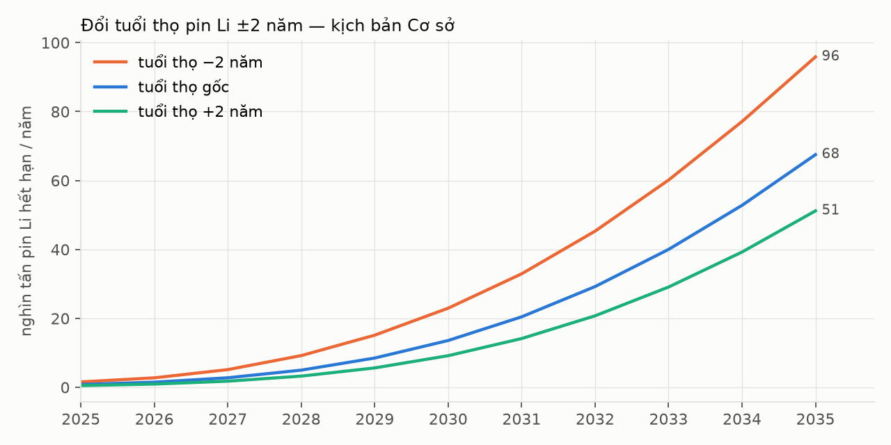
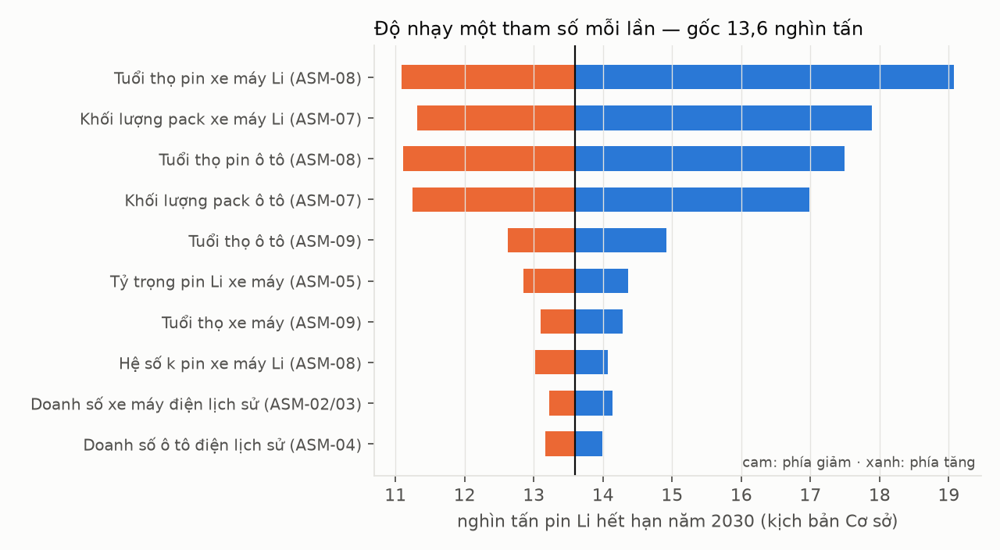

# S11 — Báo cáo phản biện dự báo

Mã nguồn: [sensitivity.py](model/sensitivity.py). Số liệu: [lifetime_shift.csv](outputs/lifetime_shift.csv) · [tornado.csv](outputs/tornado.csv) · [benchmark.csv](outputs/benchmark.csv).

## 1. Tuổi thọ pin ±2 năm

| Kịch bản | Tuổi thọ pin Li | Pin Li hết hạn 2030 (nghìn tấn) | 2035 | Năm vượt 10 nghìn tấn | Năm vượt 30 nghìn tấn |
|---|---|---|---|---|---|
| Cơ sở | −2 năm | 23,0 | 95,9 | 2029 | 2031 |
| Cơ sở | gốc | 13,6 | 67,5 | 2030 | 2033 |
| Cơ sở | +2 năm | 9,2 | 51,2 | 2031 | 2034 |
| Chậm | −2 / gốc / +2 | 20,1 / 12,2 / 8,3 | 75,4 / 54,1 / 41,5 | 2029 / 2030 / 2031 | 2032 / 2033 / 2034 |
| Nhanh | −2 / gốc / +2 | 27,2 / 15,6 / 10,3 | 124,7 / 86,4 / 64,7 | 2028 / 2030 / 2030 | 2031 / 2032 / 2033 |

**Đọc:** đổi tuổi thọ 2 năm làm đường cong **dịch khoảng 1 năm** (mốc 10 và 30 nghìn tấn), nhưng làm **lượng năm 2030 thay đổi −32% đến +69%**. Đỉnh không nằm trong khung 2025–2035 vì doanh số còn tăng; câu hỏi "đỉnh dịch bao nhiêu" được thay bằng "mốc ngưỡng dịch bao nhiêu".

## 2. Độ nhạy từng tham số (tornado)

| Hạng | Tham số | 2030 thấp – cao (nghìn tấn) | Biên độ |
|---|---|---|---|
| 1 | Tuổi thọ pin xe máy Li (ASM-08) | 11,1 – 19,1 | 8,0 |
| 2 | Khối lượng pack xe máy Li (ASM-07) | 11,3 – 17,9 | 6,6 |
| 3 | Tuổi thọ pin ô tô (ASM-08) | 11,1 – 17,5 | 6,4 |
| 4 | Khối lượng pack ô tô (ASM-07) | 11,2 – 17,0 | 5,7 |
| 5 | Tuổi thọ ô tô (ASM-09) | 12,6 – 14,9 | 2,3 |
| 6–10 | Tỷ trọng Li, tuổi thọ xe máy, hệ số k, doanh số lịch sử xe máy và ô tô | — | ≤1,5 mỗi tham số |

**Đọc:** sai số đến từ **thông số pin** (tuổi thọ, khối lượng), không phải từ doanh số lịch sử. Ưu tiên thu thập dữ liệu: (1) phân bố tuổi pin khi thay tại đại lý — chính nền tảng sẽ tạo ra dữ liệu này (MOD-COL); (2) khối lượng pack thực tế theo model (MOD-REG).

## 3. Đối chiếu với nguồn độc lập

| Kiểm tra | Mô hình | Tham chiếu | Kết quả |
|---|---|---|---|
| Xe máy Li bán 2023 ≥ VinFast giao 2023 | 112.000 | 70.300 (SRC-007) | Đạt |
| Xe máy Li bán 2024 ≥ VinFast giao 2024 | 108.000 | 70.980 (SRC-006) | Đạt |
| Xe máy Li bán 2025 ≥ VinFast giao 2025 | 477.750 | 406.498 (SRC-005) | Đạt |
| Lũy kế xe máy Li 2015–2022 ≥ VinFast lũy kế đến 2022 | 262.865 | 162.000 (SRC-007) | Đạt |
| Lũy kế xe máy Li 2015–2025 ≥ VinFast lũy kế xe hai bánh | 960.615 | 709.775 (SRC-005) | Đạt |
| Pin Li đưa ra thị trường năm 2030 | 1,98 triệu pin | ~2 triệu pin (World Bank, qua SRC-008) | Lệch 1% |
| Pin Li đưa ra thị trường lũy kế 2021–2030 | 88 GWh | ~100 GWh năm 2030 (World Bank, qua SRC-008) | Lệch −12% (định nghĩa WB chưa rõ là lũy kế hay năm) |
| Xe máy điện 2025 | 735 nghìn (dùng làm đầu vào) | IEA ~735 nghìn (SRC-011) | **Không độc lập** — cùng nguồn |

**Đọc:** mô hình nhất quán với số VinFast công bố cho SEC và với ước tính World Bank được báo chí dẫn. Không so được với IEA một cách độc lập vì IEA là đầu vào năm 2025 (DEC-05).

## 4. Phần không quan sát được: khu vực phi chính thức

| Chỉ số năm 2030 (Cơ sở) | Thấp | Likely | Cao | Căn cứ |
|---|---|---|---|---|
| Tỷ lệ pin Li hết hạn đi kênh phi chính thức | 50% | 65% | 80% | ASM-11 (nội suy 2025→2035) |
| Khối lượng pin Li vào kênh phi chính thức (nghìn tấn) | ≈6,8 | ≈8,8 | ≈10,9 | × pin Li hết hạn likely 13,6 |
| Tỷ lệ ắc quy chì đi kênh phi chính thức | 55% | 72,5% | 87,5% | ASM-11 Chì |
| Ắc quy chì vào kênh phi chính thức (nghìn tấn) | ≈18,2 | ≈23,9 | ≈28,9 | × ắc quy chì hết hạn likely 33,0 |

**Phát hiện:** ở mọi kịch bản, **phần lớn pin hết hạn năm 2030 không đi qua kênh có chứng từ**. Đây là phát hiện quan trọng nhất của dự báo, nhưng cũng là phần kém chắc chắn nhất: không có số đo trực tiếp nào. Nền tảng (MOD-COL + MOD-EPR) là công cụ để biến phần này thành dữ liệu quan sát được cho VELIX.

## 5. Độ vênh giữa các nguồn

| Chỉ số | Nguồn A | Nguồn B | Chênh | Xử lý |
|---|---|---|---|---|
| Xe máy điện 2019 | 152.000 (SRC-021) | 162.000 (SRC-020) | 6,6% | Khoảng 152–162 nghìn |
| VinFast xe máy điện 2025 | 406.498 toàn cầu (SRC-005) | 406.453 tại VN (SRC-012) | 45 xe | ASM-01 |
| Tổng xe hai bánh 2025 | 2,6 triệu (VAMA thành viên) | 3,1–3,4 triệu (SRC-018) | đến 31% | ASM-02 khoảng 2,8–3,4 |
| Thị phần VinFast xe máy điện 2025 | 43% (Kirin, qua tìm kiếm) | 55% (= 406/735, mô hình) · 81% (Marqstats) | 38 điểm | Không dùng thị phần làm đầu vào |
| Ô tô VinFast 2025 | ~170 nghìn tại VN (SRC-013, sơ bộ) | 196.918 EV toàn cầu (SRC-005, suy từ lũy kế) | 14% | Likely 185 nghìn gồm hãng khác |

## 6. Giới hạn và điều kiện làm đổi kết luận

| Giới hạn | Ảnh hưởng | Điều kiện làm đổi kết luận |
|---|---|---|
| Một hóa học pin Li chung cho xe máy | Bỏ qua khác biệt NMC/LFP | Nếu NMC chiếm >30% pin xe máy → tuổi thọ ngắn hơn, mốc sớm hơn ~1 năm |
| Không mô hình nâng cấp chì → Li (ASM-20) | Ắc quy chì có thể giảm nhanh hơn | Nếu người dùng thay chì bằng Li ở đợt thay pin |
| Doanh số tương lai tăng tuyến tính | Không có cú sốc | Lộ trình Hà Nội đổi hoặc ưu đãi mới |
| Tỷ lệ chính thức tăng tuyến tính | Không mô hình tác động chính sách 2029 | Nếu EPR 8% từ 2029 kèm chỉ tiêu thu gom → tỷ lệ chính thức tăng nhanh hơn |

**Kết luận phản biện:** khẳng định chắc chắn được là **thứ tự và mốc**: ắc quy chì trước, pin Li vượt 10 nghìn tấn/năm quanh 2029–2030, tăng khoảng 5 lần trong 2030–2035. Không khẳng định một con số duy nhất.
