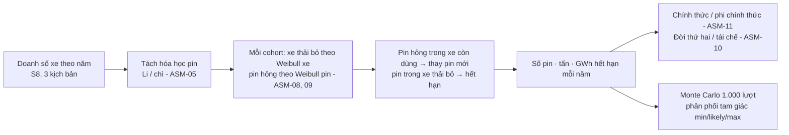
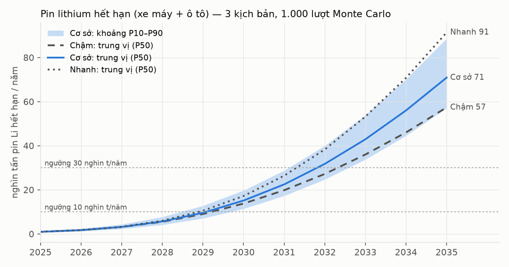
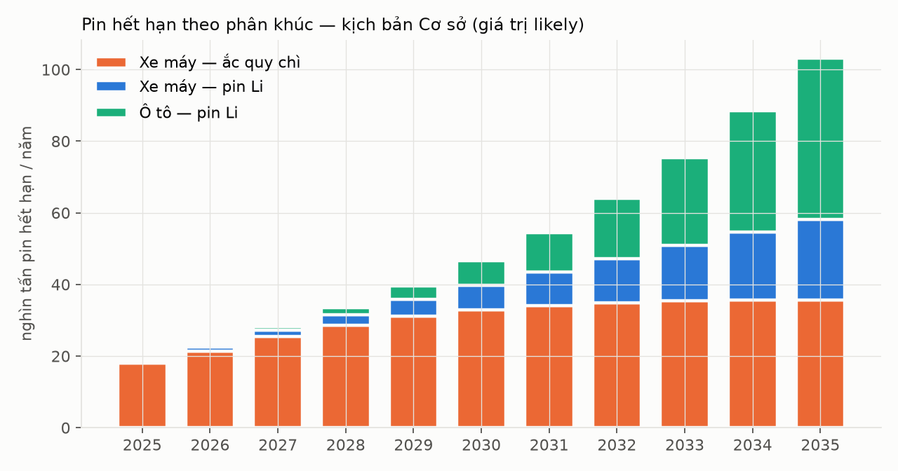

# S9 — Dự báo pin xe điện hết hạn tại Việt Nam 2025–2035

> Kết quả là **kịch bản có điều kiện**, không phải khẳng định. Mọi tham số có mã ASM/SRC; khoảng P10–P90 lấy từ 1.000 lượt Monte Carlo cho mỗi kịch bản.

## 1. Trả lời nhanh

| Câu hỏi | Trả lời (kịch bản Cơ sở) |
|---|---|
| RQ2 — Năm 2030 bao nhiêu pin Li hết hạn? | **≈15 nghìn tấn** (P10–P90: 11–20 nghìn tấn), **≈2,2 GWh** |
| RQ2 — Năm 2035? | **≈71 nghìn tấn** (57–89), **≈10 GWh** — gấp gần 5 lần năm 2030 |
| RQ3 — Năm nào vượt ngưỡng 10 nghìn tấn/năm? | **2030** (P10: 2029) — mọi kịch bản đều trong 2029–2030 |
| RQ3 — Năm nào vượt 30 nghìn tấn/năm (cỡ một nhà máy nghiền lớn)? | **2032–2033** (Nhanh: 2032; Chậm: 2033–2034) |
| RQ3 — Bao nhiêu % có thể dùng đời thứ hai? | Về kỹ thuật **≈45%** khối lượng pin Li hết hạn đủ điều kiện; thực tế chỉ **≈16%** đến được đời thứ hai năm 2030 vì 65% còn đi kênh phi chính thức |
| Phát hiện phụ | Năm 2030, **ắc quy chì xe máy vẫn lớn hơn pin Li** (≈33 so với ≈14 nghìn tấn, giá trị likely); pin Li chỉ vượt ắc quy chì từ **2033** (Nhanh 2032, Chậm 2034) |

## 2. Phương pháp

- **Đơn vị mô hình:** cohort = xe bán cùng năm, theo 3 phân khúc (xe máy pin Li, xe máy ắc quy chì, ô tô pin Li).
- **Thay pin:** pin hỏng trong xe còn dùng được thay bằng pin cùng loại (ASM-20). Pin thay thế cũng là pin "đưa ra thị trường" (tính vào V của EPR).
- **Cân bằng khối lượng:** pin đưa ra thị trường = pin hết hạn + pin đang dùng. Kiểm bằng unit test ([tests/test_forecast.py](../tests/test_forecast.py), 9/9 đạt).
- **Weibull:** λ = trung bình / Γ(1 + 1/k). Hệ số hình dạng k = 3,0 cho pin xe máy, 3,6 cho pin ô tô và phương tiện (SRC-019). Căn cứ tuổi thọ: LFP >2.000 chu kỳ, ắc quy chì 300–400 chu kỳ (SRC-022); pin ô tô 10–15 năm (SRC-008); VinFast bảo hành pin đến 10 năm (SRC-005).
- **Monte Carlo:** mỗi lượt rút một giá trị cho mỗi nhóm tham số; doanh số lịch sử rút đồng biến giữa các năm (một phân vị chung) để không triệt tiêu sai số.

Mã nguồn: [params.py](model/params.py) · [forecast.py](model/forecast.py). Chạy lại: `.venv/Scripts/python 03-forecast/model/forecast.py 1000`.

## 3. Kết quả

| Năm | Kịch bản | Pin Li hết hạn P50 (nghìn tấn) | P10–P90 | GWh P50 | Ắc quy chì hết hạn P50 (nghìn tấn) |
|---|---|---|---|---|---|
| 2025 | Cơ sở | 0,9 | 0,6–1,4 | 0,13 | 17,5 |
| 2028 | Cơ sở | 5,7 | 4,1–7,7 | 0,80 | 28,1 |
| 2030 | Chậm | 13,8 | 10,3–18,1 | 1,98 | 32,5 |
| 2030 | **Cơ sở** | **15,1** | **11,4–19,7** | **2,16** | **32,6** |
| 2030 | Nhanh | 17,2 | 13,1–23,7 | 2,45 | 32,5 |
| 2032 | Cơ sở | 31,7 | 24,7–40,0 | 4,58 | 34,6 |
| 2035 | Chậm | 57,4 | 45,6–71,9 | 8,42 | 38,9 |
| 2035 | **Cơ sở** | **70,9** | **57,0–88,6** | **10,39** | **35,8** |
| 2035 | Nhanh | 91,3 | 73,1–114,8 | 13,27 | 27,9 |

Nguồn bảng: [eol_mc_summary.csv](outputs/eol_mc_summary.csv). Giá trị *likely* (mọi tham số ở mode) thấp hơn P50 vì phân phối tham số lệch phải: năm 2030 likely = 13,6 nghìn tấn ([eol_likely.csv](outputs/eol_likely.csv)).

### Năm vượt ngưỡng công suất (RQ3, DEC-07)

| Ngưỡng (nghìn tấn pin Li/năm) | Chậm | Cơ sở | Nhanh |
|---|---|---|---|
| 2 | 2027 | 2027 | 2027 |
| 5 | 2028–2029 | 2028–2029 | 2028–2029 |
| 10 | 2029–2030 | 2029–2030 | 2029–2030 |
| 30 | 2032–2034 | 2032–2033 | 2031–2032 |

Mỗi ô là khoảng P10–P90 của năm vượt ([crossover.csv](outputs/crossover.csv)). Không có công suất tái chế pin Li công bố trong nước (ASM-12), nên bảng trả lời câu hỏi ngược lại: **từ năm nào lượng pin đủ nuôi một nhà máy cỡ X**.

## 4. Ý nghĩa cho VELIX và chính sách

1. **Mốc 2029 của NĐ 110 (REQ-VN-11) trùng với năm lượng pin Li hết hạn vượt 10 nghìn tấn/năm.** Lý do "chưa đủ pin thải để vận hành nhà máy" (SRC-008) đúng cho 2026–2028 nhưng hết đúng từ khoảng 2029–2030.
2. **Ắc quy chì là bài toán của hiện tại.** ≈33 nghìn tấn/năm đến 2030, phần lớn qua kênh phi chính thức (S10). Nghĩa vụ 12% đã có (REQ-VN-15).
3. **Pin ô tô chiếm phần lớn khối lượng Li sau 2032** vì mỗi pack nặng ≈260 kg. Với VELIX (chỉ bán xe máy), dòng pin của mình nhỏ hơn nhiều; xem S21.
