# S12 — Vision & Scope

## 1. Tầm nhìn

**Cho** doanh nghiệp xe máy điện chịu nghĩa vụ EPR,
**những người cần** biết từng pin đang ở đâu và đi về đâu khi hết hạn,
**Battery 2030** là **nền tảng quản lý vòng đời pin**
**giúp** tuân thủ NĐ 110/2026 đúng hạn, đo được tỷ lệ thu hồi và đưa pin còn tốt vào đời thứ hai.
**Khác với** bảng tính tổng hợp cuối năm, nền tảng ghi nhận dữ liệu tại từng điểm chạm của pin và dùng chuẩn dữ liệu battery passport.

## 2. Mục tiêu kinh doanh

Xem OBJ-1 – OBJ-5 ở [S1-charter.md](../01-discovery/S1-charter.md).

## 3. Sơ đồ chức năng nghiệp vụ (BFD)

```mermaid
flowchart TB
  R[Battery 2030]
  R --> M1[MOD-REG<br/>Sổ đăng ký pin]
  R --> M2[MOD-COL<br/>Thu hồi]
  R --> M3[MOD-SOH<br/>Đánh giá SoH]
  R --> M4[MOD-RTE<br/>Điều phối]
  R --> M5[MOD-PTN<br/>Đối tác]
  R --> M6[MOD-EPR<br/>Báo cáo EPR]
  R --> M7[MOD-PSP<br/>Hồ sơ pin]
  R --> M8[MOD-ADM<br/>Quản trị]
  M1 --> F01[Model pin] & F02[Cấp mã khi bán] & F03[Cờ loại trừ] & F04[Tra cứu]
  M2 --> F05[Điểm thu hồi] & F06[Tiếp nhận] & F07[Ngoại tuyến] & F08[Gom lô] & F09[Chứng từ] & F10[Cổng công khai]
  M3 --> F11[Dữ liệu BMS] & F12[Ước lượng] & F13[Đo tay / ghi đè]
  M4 --> F14[Đề xuất] & F15[Phê duyệt] & F16[Bàn giao đời thứ hai]
  M5 --> F17[Giấy phép] & F18[Chặn bàn giao] & F19[Xác nhận tái chế]
  M6 --> F20[Tham số quy định] & F21[Hình thức] & F22[Khối lượng] & F23[Tính F] & F24[Xuất hồ sơ] & F25[Nhắc hạn] & F26[Bảng điều khiển]
  M7 --> F27[Passport] & F28[Dòng thời gian] & F29[Hồ sơ đời thứ hai] & F30[Đóng hồ sơ]
  M8 --> F31[Vai trò & phạm vi] & F32[Nhật ký] & F33[Tham số vận hành]
```

Mỗi nút F01 – F33 tương ứng FR-01 – FR-33 trong [S14-srs.md](S14-srs.md).

## 4. Phạm vi theo bản phát hành

| Bản | Nội dung | Điều kiện |
|---|---|---|
| **MVP** (Q1/2027) | 25 user story nhãn MVP: đăng ký, tiếp nhận trực tuyến, SoH có người duyệt, điều phối, lô và chứng từ, báo cáo EPR năm 2026, bảng điều khiển, cổng công khai | Kịp hạn 01/4/2027 cho năm trách nhiệm 2026 (OBJ-1) |
| **R2** (Q3/2027) | US-08 tiếp nhận ngoại tuyến; US-17 bàn giao đời thứ hai có hồ sơ mới; bật quyết định SoH tự động khi đạt AIR-03/04 | DEC-11 |
| **R3** (2028) | Kết nối API Hệ thống EPR quốc gia khi có đặc tả; chia sẻ passport cho đối tác; chế độ PRO đa nhà sản xuất | Văn bản hướng dẫn mới |

Chi tiết cắt MVP: [S16-story-map.md](S16-story-map.md).

## 5. Ngoài phạm vi

Theo [S1-charter.md](../01-discovery/S1-charter.md) §3. Bổ sung: không xây dựng thiết bị đọc BMS; không thanh toán cho người trả pin (ưu đãi xử lý ở hệ thống bán hàng).

## 6. Giả định và phụ thuộc

| Mã | Nội dung |
|---|---|
| DEP-1 | ERP gửi đơn bán có số khung và mã model pin |
| DEP-2 | Mỗi điểm thu hồi có hồ sơ chủ nguồn thải CTNH trước khi kích hoạt (BR-09) |
| DEP-3 | Đơn vị tái chế dùng cổng đối tác để cân và xác nhận |
| DEP-4 | Mẫu biểu EPR của Bộ NN&MT không đổi cấu trúc trường cơ bản trong năm (LQ-05) |
