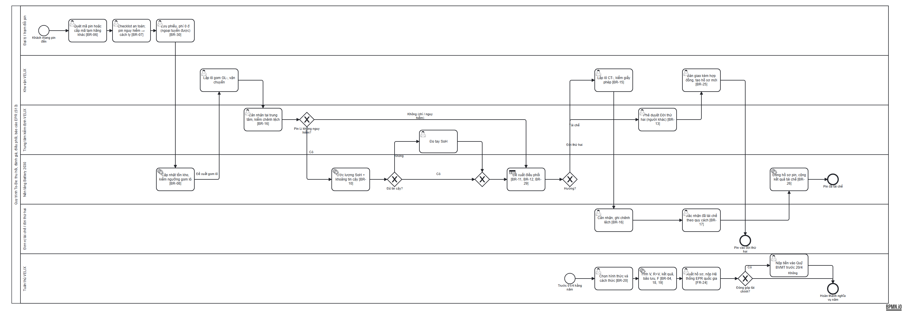
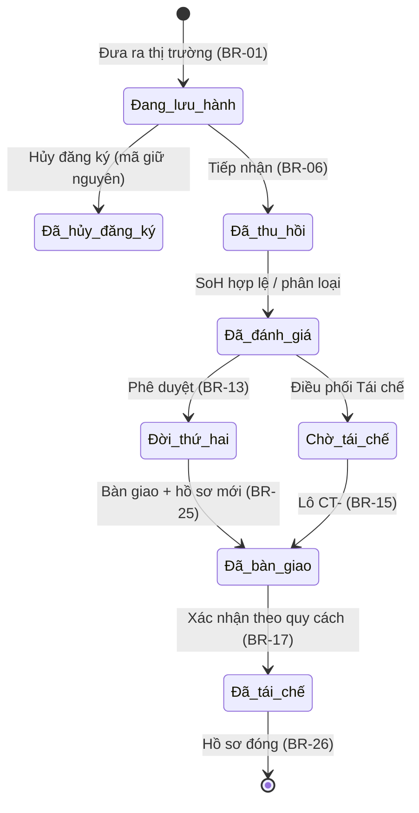
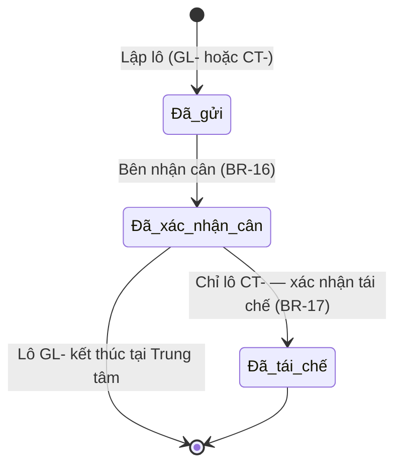
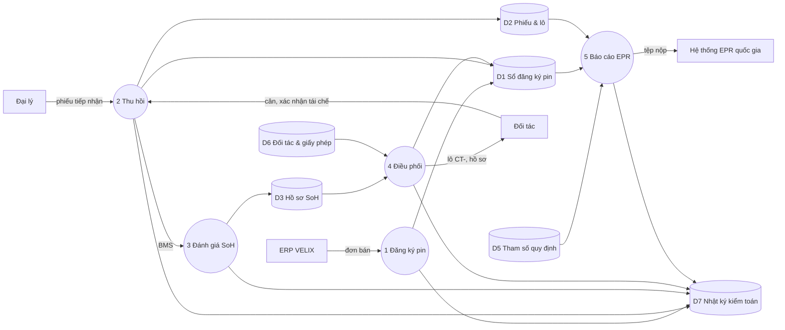

# S13 — Quy trình mục tiêu (To-Be)

Nguồn BPMN 2.0: [to-be.bpmn](to-be.bpmn) (sinh bằng [build_to_be.py](build_to_be.py); mở bằng demo.bpmn.io hoặc Camunda Modeler).

## 1. Luồng chính

| Bước | Lane | Việc | Quy tắc | Màn hình prototype |
|---|---|---|---|---|
| 1 | Đại lý | Quét mã pin, hoặc cấp mã tạm cho pin hãng khác | BR-06 | Tiếp nhận pin |
| 2 | Đại lý | Checklist an toàn; pin nguy hiểm vào thùng cách ly | BR-07 | Tiếp nhận pin |
| 3 | Đại lý | Lưu phiếu, phí 0 đ; mất mạng thì lưu trên thiết bị | BR-30 | Tiếp nhận pin |
| 4 | Nền tảng | Cập nhật tồn kho, đề xuất gom lô theo ngưỡng | BR-08 | Điểm thu hồi |
| 5 | Kho vận | Lập lô gom GL-, vận chuyển về Trung tâm kiểm định | BR-16 | Điểm thu hồi → Lô |
| 6 | Trung tâm | Cân nhận, kiểm chênh lệch | BR-16 | Lô & chứng từ |
| 7 | Nền tảng | Pin Li không nguy hiểm: ước lượng SoH kèm khoảng tin cậy | BR-10 | Đánh giá SoH |
| 8 | Trung tâm | Không đủ tin cậy: đo tay | BR-10 | Đánh giá SoH |
| 9 | Nền tảng | Đề xuất hướng điều phối theo bảng quyết định | BR-11, 12, 29 | Điều phối |
| 10a | Trung tâm → Kho vận | Đời thứ hai: người khác phê duyệt; bàn giao kèm hợp đồng; tạo hồ sơ mới | BR-13, 25 | Điều phối |
| 10b | Kho vận → Đơn vị tái chế | Tái chế: lập lô CT-, kiểm giấy phép; bên nhận cân, xác nhận đã tái chế | BR-15, 16, 17 | Lô & chứng từ |
| 11 | Nền tảng | Đóng hồ sơ pin, cộng kết quả tái chế | BR-26 | Hồ sơ pin |
| 12 | Tuân thủ | Trước 01/4: chọn hình thức, tính V, R × V, F, xuất hồ sơ; đóng quỹ thì nộp tiền trước 20/4 | BR-19 – 21 | Báo cáo EPR |

## 2. Gap analysis As-Is → To-Be

| Khía cạnh | As-Is (S7) | To-Be | Điểm đau được giải | Thay đổi cần có |
|---|---|---|---|---|
| Dữ liệu | Không có mã pin; V từ 3 file | Mã định danh từ lúc bán; V tự tổng hợp | PP-05, PP-06 | Tích hợp ERP; MOD-REG |
| Quy trình tại đại lý | Giữ pin cũ, bán đồng nát | Tiếp nhận chuẩn, cách ly, gom lô theo ngưỡng | PP-01, PP-03 | Đào tạo đại lý; thùng chứa; MOD-COL |
| Người dùng | Không biết trả pin ở đâu | Cổng tra cứu; nhận mọi hãng, miễn phí | PP-02 | Truyền thông; FR-10 |
| Đánh giá pin | Không có | SoH có độ tin cậy, đo tay khi cần | — | Thiết bị đo tại trung tâm; MOD-SOH |
| Quyết định | Không có | Bảng quyết định + phê duyệt hai người | — | Quy chế nội bộ; MOD-RTE |
| Đối tác | Bán theo lô, không gắn pin | Kiểm giấy phép, chứng từ theo pin, xác nhận tái chế | PP-04, PP-05 | Hợp đồng với đơn vị tái chế; MOD-PTN |
| Báo cáo | Thủ công | Tham số theo năm, tính tự động, xuất hồ sơ | PP-07 | MOD-EPR |

## 3. Máy trạng thái của pin (BR-24)

Trạng thái passport: *Đang lưu hành* và *Đã hủy đăng ký* = `original`; từ *Đã thu hồi* trở đi = `waste`; hồ sơ mới của pin đời thứ hai = `repurposed`; *Đã tái chế* = hồ sơ đóng (Art. 77(8)). Bảng chuyển trạng thái có đúng 8 cặp hợp lệ, kiểm bằng TC-064.

## 4. Máy trạng thái của lô

## 5. Sơ đồ luồng dữ liệu mức 1

## 6. Chỉ số đo quy trình To-Be

| KPI | Định nghĩa | Mục tiêu | Nguồn dữ liệu |
|---|---|---|---|
| Tỷ lệ pin bán ra có mã | Pin có mã / pin đưa ra thị trường | 100% (OBJ-2) | MOD-REG |
| Tỷ lệ thu gom (chuẩn EU) | BR-23 | Báo cáo hằng tháng (OBJ-3) | MOD-EPR |
| Thời gian tiếp nhận | Mở form → lưu | ≤ 3 phút (NFR-01) | Nhật ký thao tác |
| Pin có SoH hợp lệ trước khi điều phối Li | Đếm | 100% (OBJ-4) | MOD-SOH |
| Pin Nguy hiểm lưu tại điểm | Giờ | ≤ 72 (PAR-04) | MOD-COL |
| Hồ sơ EPR nộp đúng hạn | Ngày nộp ≤ 31/3 | 100% (OBJ-1) | MOD-EPR |
