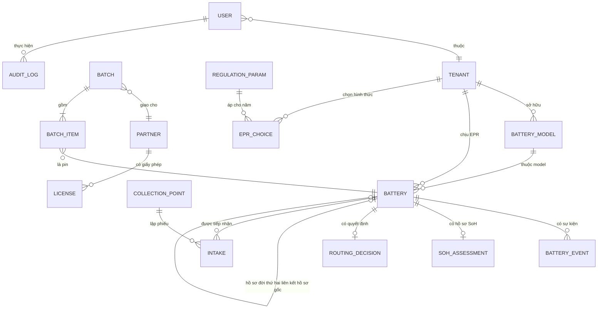

# S15 — Mô hình dữ liệu

## 1. ERD

## 2. Từ điển dữ liệu

Cột **BP#** là số thứ tự thuộc tính trong Battery Pass Data Attribute Longlist v1.2 ([passport-field-map.csv](../02-regulatory/passport-field-map.csv)).

### battery_model

| Trường | Kiểu | Bắt buộc | Mô tả | Quy tắc | BP# |
|---|---|---|---|---|---|
| code | varchar(8) | Có | Mã model, in hoa/số | Duy nhất trong tenant | — |
| name | varchar(120) | Có | Tên thương mại | — | — |
| chemistry | enum(LFP, NMC, Li khác, NiMH, Chì) | Có | Hóa học pin | BR-03 | 31 |
| use | enum(Phương tiện giao thông, Khác) | Có | Mục đích | BR-03 | — |
| capacity_ah | decimal(6,1) | Có | Dung lượng danh định | — | 52 |
| voltage_v | decimal(5,1) | Có | Điện áp danh định | — | 61 |
| energy_kwh | decimal(6,2) | Có | Năng lượng | >0 | — |
| mass_kg | decimal(6,1) | Có | Khối lượng pack | >0; dùng cho V | 10 |
| category_vn | enum(B.1.1, B.2.1, B.2.1-khác) | Hệ thống | Nhóm Phụ lục I NĐ 110 | BR-03 | 9 |
| category_eu | enum(LMT, Pin xe điện) | Hệ thống | Nhóm EU | BR-03, PAR-02 | 9 |
| manufacturer | varchar(120) | Có | Nhà sản xuất | — | 4 |
| labeler | varchar(120) | Có | Bên ghi nhãn = chủ thể EPR | BR-05 | 4 |
| warranty_months | int | Có | Bảo hành | — | 8 |
| original_power_w, initial_resistance_mohm, expected_life_cycles, expected_life_years, capacity_threshold_pct | số | Không | Thông số hiệu năng | — | 62, 74, 77, 76, 83 |
| hazardous_substances | text | Không | Chất nguy hại | — | 34 |
| manufacturing_place | varchar(120) | Có | Nơi sản xuất | — | 5 |
| dismantling_doc_url, safety_doc_url | url | Có | Tài liệu tháo dỡ, an toàn | — | 36, 39 |

### battery

| Trường | Kiểu | Bắt buộc | Mô tả | Quy tắc | BP# |
|---|---|---|---|---|---|
| battery_uid | varchar(32) | Có | Mã định danh | BR-01, BR-02; duy nhất toàn hệ thống | 2 |
| tenant_id | fk | Có | Nhà sản xuất | BR-27 | — |
| model_code | fk | Có* | Model (*trừ pin hãng khác) | — | — |
| kind | enum(Theo xe, Thay thế, Hãng khác, Đời thứ hai) | Có | Nguồn gốc bản ghi | — | — |
| placed_date | date | Có* | Ngày đưa ra thị trường | Năm trách nhiệm | 6 |
| vin | varchar(17) | Không | Số khung xe | — | — |
| manufacturing_date | date | Có* | Ngày sản xuất pin (từ nhà cung cấp) | — | 6 |
| put_into_service_date | date | Không | Ngày bàn giao cho người dùng | — | 7 |
| status | enum (8 trạng thái S13 §3) | Có | Trạng thái vòng đời | BR-24 | 11 |
| passport_status | enum(original, repurposed, waste) | Hệ thống | Trạng thái passport | BR-24 | 11 |
| flags | set(Xuất khẩu, Thử nghiệm, NCC đã thực hiện EPR, Hãng khác) | Không | Cờ | BR-04, BR-06 | — |
| hazard | bool | Có | Cờ Nguy hiểm | BR-07 | 93 |
| location_id | fk | Không | Điểm thu hồi / Trung tâm / đối tác | — | — |
| parent_uid | fk(battery) | Không | Hồ sơ gốc của pin đời thứ hai | BR-25 | — |
| producer_partner_id | fk(partner) | Không | Chủ thể đưa ra thị trường pin đời thứ hai | BR-25 | 3 |
| other_mass_kg, other_chemistry | số, enum | Có với pin hãng khác | Khối lượng cân, hóa học | BR-06 | — |
| closed | bool | Hệ thống | Hồ sơ chỉ đọc | BR-26 | — |

### intake (phiếu tiếp nhận)

| Trường | Kiểu | Mô tả | Quy tắc |
|---|---|---|---|
| intake_id | varchar(24) | `[mã thiết bị]-[số thứ tự]` | BR-30 duy nhất |
| point_id | fk | Điểm thu hồi | BR-09 |
| battery_uid | fk | Pin | — |
| intake_at | timestamp | Thời điểm | BR-08 |
| checklist | set(Phồng, Rò rỉ, Nứt vỏ, Đã va chạm, Nóng bất thường) | An toàn | BR-07 |
| weight_kg | decimal | Khối lượng cân | — |
| fee_vnd | int = 0 | Phí người trả | BR-06 |
| device_id, synced_at | — | Ngoại tuyến | BR-30 |

### soh_assessment

| Trường | Kiểu | Mô tả | BP# |
|---|---|---|---|
| remaining_capacity_ah, resistance_increase_pct, full_cycles, deep_discharge_events, hours_extreme_temp | số | Dữ liệu BMS bắt buộc cho BR-10 (Phụ lục VII); hours_extreme_temp = tổng bốn trường giờ bên dưới | 53, 75, 78, 91 |
| hours_above_temp, hours_below_temp, hours_charge_above_temp, hours_charge_below_temp | số | Giờ ở / sạc ở nhiệt độ khắc nghiệt | 87, 88, 89, 90 |
| soc_pct, soce_pct, remaining_power_w, energy_throughput_kwh, capacity_throughput_ah, temperature_log_ref | số, text | Dữ liệu BMS bổ sung (SOCE chỉ với pin xe điện) | 58, 57, 63, 81, 82, 84 |
| model_estimate_pct, ci_low_pct, ci_high_pct, model_version | số, text | Kết quả mô hình | — |
| manual_pct | số | Đo tay | — |
| override_pct, override_reason | số, text | Ghi đè | — |
| source | enum(Mô hình, Đo tay) | Nguồn hồ sơ hợp lệ | — |
| valid, assessed_at, assessed_by | — | — | — |

### passport, public_content

| Bảng | Trường | Mô tả | BP# |
|---|---|---|---|
| passport | passport_id, battery_uid, passport_status, created_at, closed_at | Hồ sơ điện tử; passport_id dẫn từ QR | 1 |
| public_content | end_user_info | Hướng dẫn thải pin, điểm trả pin (cổng công khai) | 49, 50, 51 |

### routing_decision

| Trường | Mô tả | Quy tắc |
|---|---|---|
| proposed, final | Đời thứ hai / Tái chế | BR-12 |
| proposed_by, approved_by | Người đề xuất / phê duyệt (khác nhau) | BR-13 |
| contract_no | Số hợp đồng / hóa đơn chuyển giao | BR-25 |

### collection_point, partner, license

| Bảng | Trường chính | Quy tắc |
|---|---|---|
| collection_point | point_id, name, type, province, address, hours, capacity_kg, ctnh_code, ctnh_valid_from, active | BR-08, BR-09 |
| partner | partner_id, name, type (Đơn vị tái chế / đời thứ hai / PRO / vận chuyển) | — |
| license | license_no, valid_from, valid_to, groups (B.1.1, B.2.1) | BR-15 |

### batch, batch_item

| Trường | Mô tả | Quy tắc |
|---|---|---|
| batch_id | `GL-YYYY-NNNN` (gom về trung tâm) hoặc `CT-YYYY-NNNN` (bàn giao đối tác) | BR-16 duy nhất |
| kind, from_id, to_id, date | Loại, nơi gửi, nơi nhận | — |
| sent_kg, received_kg, variance_reason | Khối lượng gửi, cân nhận, lý do chênh lệch | BR-16 |
| status | Đã gửi → Đã xác nhận cân → Đã tái chế | S13 §4 |
| recycled_date | Ngày xác nhận tái chế | BR-17 |
| batch_item(batch_id, battery_uid) | Danh sách pin | — |

### regulation_param, epr_choice, carryover

| Bảng | Trường | Quy tắc |
|---|---|---|
| regulation_param | year, group, R, Fs, basis, deadline_plan, deadline_payment | BR-19, BR-22, PAR-10 |
| epr_choice | tenant, year, group, form, method | BR-20 |
| carryover | tenant, group, from_year, kg, used_kg | BR-18 |

### audit_log

| Trường | Mô tả | Quy tắc |
|---|---|---|
| at, user_id, role, object, field, old_value, new_value, reason | Mỗi thay đổi dữ liệu nghiệp vụ | BR-14, NFR-06; chỉ ghi thêm |

## 3. Ánh xạ dữ liệu nguồn → nền tảng

| Nguồn | Trường nguồn | Trường nền tảng | Biến đổi |
|---|---|---|---|
| ERP đơn bán | sku_model | battery.model_code | Tra bảng ánh xạ SKU → model |
| ERP đơn bán | invoice_date | battery.placed_date | Ngày giao cho bên mua (Điều 3.3 NĐ 110: chuyển giao lần đầu) |
| ERP đơn bán | vin | battery.vin | — |
| ERP phiếu xuất pin thay thế | part_no, date | battery (kind = Thay thế) | Mỗi pin một bản ghi |
| ERP tờ khai hải quan | hs_code, qty | Đối chiếu V | Báo cáo đối soát (REQ-VN-30) |
| Nhà cung cấp pin | thông số model | battery_model | Nhập khi có model mới |
| Đầu đọc BMS | remaining_capacity… | soh_assessment | Đơn vị chuẩn hóa: Ah, %, chu kỳ, giờ |
| Đơn vị tái chế | biên bản cân | batch.received_kg | kg, 1 chữ số thập phân |
| Battery Pass | 39 thuộc tính MVP | Bảng ở §2 | Xuất JSON theo tên thuộc tính Battery Pass (NFR-07) |
