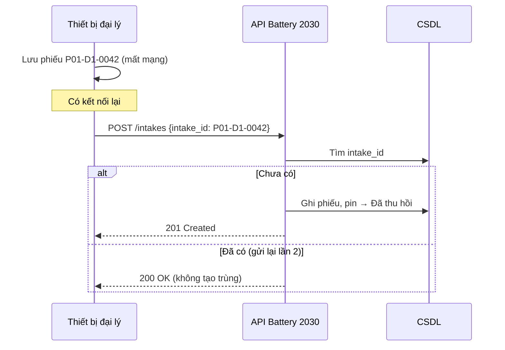
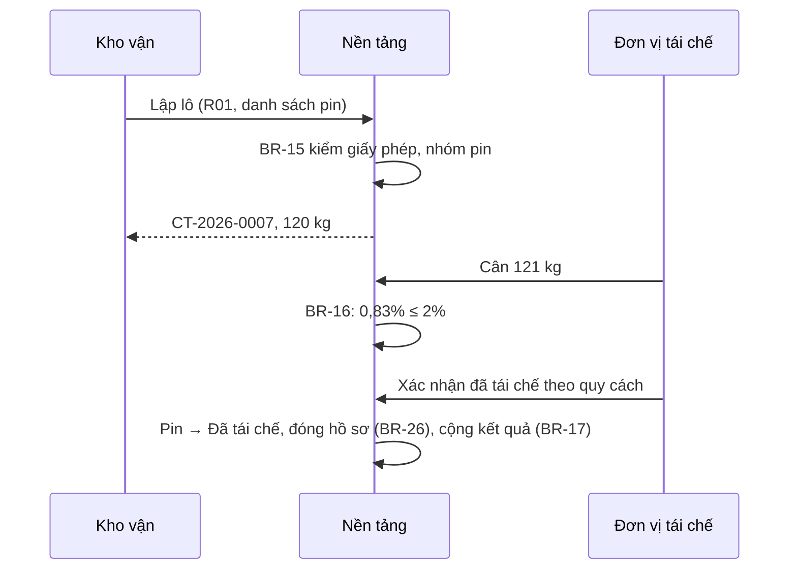

# Đặc tả giao tiếp

Hợp đồng API: [api-spec.yaml](api-spec.yaml) (OpenAPI 3.0.3, bản nháp).

| Mã | Giao tiếp | Chiều | Cách | Tần suất | Lỗi và xử lý |
|---|---|---|---|---|---|
| IF-01 | ERP → đăng ký pin | Vào | `POST /batteries` | Gần thời gian thực (sự kiện đơn bán) | 409 trùng → ERP không gửi lại; 422 model chưa đăng ký → hàng chờ xử lý tay |
| IF-02 | Thiết bị đại lý → phiếu tiếp nhận | Vào | `POST /intakes`, idempotent theo `intake_id` | Mỗi lần tiếp nhận; gửi lại khi có mạng | 200 nếu đã có → coi như thành công (BR-30) |
| IF-03 | Nền tảng → mô hình SoH | Ra/vào | `POST /soh-estimates` | Mỗi pin Li | Hết thời gian 5 s → chuyển đo tay |
| IF-04 | Nền tảng ↔ đơn vị tái chế | Hai chiều | Cổng đối tác + `POST /batches/{id}/weighing`, `/recycled` | Mỗi lô | 422 thiếu lý do chênh lệch |
| IF-05 | Nền tảng → Hệ thống EPR quốc gia | Ra | Tệp CSV (RPT-02), nộp thủ công | Hằng năm | Chưa có API công bố (LQ-05) |
| IF-06 | Nền tảng → đối tác đời thứ hai | Ra | `GET /batteries/{uid}/passport` | Khi bàn giao | Quyền theo lô (BR-27) |

## Sequence — tiếp nhận ngoại tuyến (BR-30)



## Sequence — đánh giá SoH và điều phối

```mermaid
sequenceDiagram
  participant T as Kỹ thuật viên
  participant P as Nền tảng
  participant M as Mô hình SoH
  participant L as Trưởng dịch vụ
  P->>M: POST /soh-estimates (dữ liệu BMS)
  M-->>P: soh 82, [79; 85], soh-demo-0.1
  P->>P: BR-10: đủ tin cậy?
  alt Không đủ
    P-->>T: Chờ đo tay + lý do
    T->>P: SoH đo tay
  else Đủ
    T->>P: Xác nhận
  end
  P->>P: BR-12: đề xuất hướng
  T->>P: Chọn Đời thứ hai
  L->>P: Phê duyệt (khác người đề xuất, BR-13)
```

## Sequence — bàn giao tái chế


