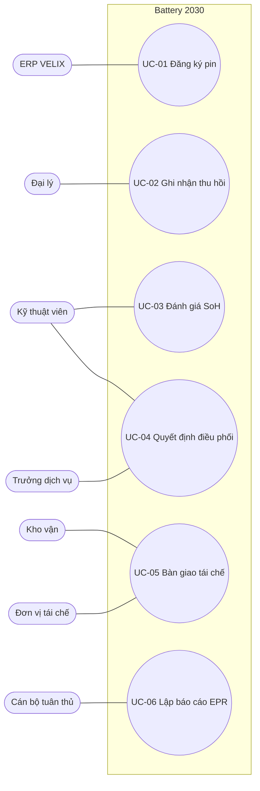

# Use case lõi

## UC-01 Đăng ký pin khi đưa ra thị trường

| Mục | Nội dung |
|---|---|
| Tác nhân | ERP (chính), Cán bộ tuân thủ |
| Tiền điều kiện | Model pin đã đăng ký (FR-01) |
| Kích hoạt | ERP gửi đơn bán hoặc phiếu xuất pin thay thế |
| Luồng chính | 1. Hệ thống nhận đơn (model, ngày, số khung). 2. Tăng số thứ tự, sinh mã theo BR-02. 3. Kiểm mã chưa tồn tại (BR-01). 4. Tạo pin trạng thái Đang lưu hành, sự kiện Đăng ký. 5. Ghi nhật ký. |
| Luồng thay thế | A1. Pin xuất khẩu / thử nghiệm / NCC đã làm EPR: Cán bộ tuân thủ gắn cờ (FR-03) → loại khỏi V (BR-04). A2. Đơn bị hủy: Hủy đăng ký, mã giữ nguyên không cấp lại. |
| Ngoại lệ | E1. Model chưa đăng ký → từ chối đơn, báo ERP. E2. Mã trùng → dừng, báo lỗi (không xảy ra nếu số thứ tự tăng đơn điệu). |
| Hậu điều kiện | Pin có mã; được tính vào V năm đưa ra thị trường |
| Quy tắc | BR-01, 02, 03, 04, 05 |
| Test | TC-001 – TC-011 |

## UC-02 Ghi nhận thu hồi tại điểm

| Mục | Nội dung |
|---|---|
| Tác nhân | Đại lý / trạm đổi pin |
| Tiền điều kiện | Điểm thu hồi Hoạt động (BR-09) |
| Kích hoạt | Người dùng mang pin đến |
| Luồng chính | 1. Quét mã pin. 2. Hệ thống điền khối lượng theo model. 3. Đại lý tick checklist an toàn. 4. (Tùy chọn) nhập dữ liệu BMS. 5. Lưu phiếu, phí 0 đ. 6. Pin chuyển Đã thu hồi; tồn kho tăng; kiểm ngưỡng gom lô (BR-08). |
| Luồng thay thế | A1. Pin hãng khác: cấp mã tạm, gắn cờ (BR-06). A2. Có dấu hiệu nguy hiểm: cờ Nguy hiểm, hướng dẫn cách ly (BR-07). A3. Mất kết nối: phiếu lưu trên thiết bị, đồng bộ sau (BR-30). |
| Ngoại lệ | E1. Mã không tồn tại → gợi ý chọn Pin hãng khác. E2. Pin không ở trạng thái Đang lưu hành → từ chối. E3. Điểm chưa kích hoạt → chặn. |
| Hậu điều kiện | Phiếu có số duy nhất; pin ở điểm thu hồi |
| Quy tắc | BR-06, 07, 08, 09, 24, 28, 30 |
| Test | TC-012 – TC-023, TC-070, TC-071 |

## UC-03 Đánh giá SoH

| Mục | Nội dung |
|---|---|
| Tác nhân | Kỹ thuật viên |
| Tiền điều kiện | Pin Li ở trạng thái Đã thu hồi |
| Luồng chính | 1. Hệ thống gửi dữ liệu BMS cho mô hình, nhận SoH và khoảng 90%. 2. Áp quy tắc BR-10. 3. Hợp lệ: kỹ thuật viên xác nhận → Đã đánh giá. |
| Luồng thay thế | A1. Chờ đo tay: kỹ thuật viên đo và nhập kết quả → hồ sơ hợp lệ nguồn Đo tay. A2. Ghi đè có lý do (BR-14). A3. MVP chế độ song song (DEC-11): mọi pin đi A1, kết quả mô hình chỉ lưu để so sánh. |
| Ngoại lệ | E1. Ghi đè thiếu lý do → chặn. E2. SoH ngoài 0–100 → chặn. |
| Hậu điều kiện | Hồ sơ SoH hợp lệ có nguồn |
| Quy tắc | BR-10, 14 |
| Test | TC-024 – TC-031 |

## UC-04 Quyết định điều phối

| Mục | Nội dung |
|---|---|
| Tác nhân | Kỹ thuật viên (đề xuất), Trưởng dịch vụ (phê duyệt), Kho vận (bàn giao) |
| Tiền điều kiện | Pin Đã đánh giá, hoặc pin chì / hãng khác tại Trung tâm |
| Luồng chính | 1. Hệ thống đề xuất theo bảng quyết định S14 §3.1. 2. Kỹ thuật viên chọn Tái chế → Chờ tái chế. |
| Luồng thay thế | A1. Chọn Đời thứ hai → chờ phê duyệt → người khác phê duyệt → Đời thứ hai → Kho vận bàn giao kèm số hợp đồng → hồ sơ mới repurposed (BR-25). |
| Ngoại lệ | E1. Đời thứ hai không được phép (chì, nguy hiểm, SoH thấp, chưa có SoH) → nút bị khóa. E2. Tự phê duyệt → chặn. E3. Thiếu số hợp đồng → chặn. |
| Hậu điều kiện | Pin có hướng điều phối cuối cùng |
| Quy tắc | BR-07, 11, 12, 13, 24, 25, 29 |
| Test | TC-017, TC-032 – TC-040 |

## UC-05 Bàn giao tái chế

| Mục | Nội dung |
|---|---|
| Tác nhân | Kho vận, Đơn vị tái chế |
| Tiền điều kiện | Có pin Chờ tái chế tại Trung tâm |
| Luồng chính | 1. Kho vận chọn đơn vị nhận và pin. 2. Hệ thống kiểm giấy phép (BR-15). 3. Sinh lô CT- với danh sách pin, khối lượng gửi. 4. Đơn vị tái chế cân, nhập khối lượng (BR-16). 5. Xác nhận đã tái chế theo quy cách → pin Đã tái chế, hồ sơ đóng (BR-17, 26). |
| Ngoại lệ | E1. Giấy phép hết hạn hoặc thiếu nhóm → chặn lập lô. E2. Chênh lệch > 2% không lý do → chặn xác nhận. |
| Hậu điều kiện | Khối lượng tính vào kết quả tái chế của nhóm |
| Quy tắc | BR-15, 16, 17, 26, 27 |
| Test | TC-041 – TC-048, TC-066 |

## UC-06 Lập báo cáo EPR

| Mục | Nội dung |
|---|---|
| Tác nhân | Cán bộ tuân thủ |
| Tiền điều kiện | Tham số năm trách nhiệm đã nạp (PAR-10) |
| Kích hoạt | Nhắc hạn 30/7/1 ngày trước 01/4 (BR-21) |
| Luồng chính | 1. Chọn hình thức và cách thức cho mỗi nhóm (BR-20). 2. Hệ thống tính V, R × V, kết quả, bảo lưu (BR-04, 17, 18), F nếu đóng quỹ (BR-19). 3. Xuất CSV, nộp lên Hệ thống EPR quốc gia. 4. Đóng quỹ: nộp tiền trước 20/4. |
| Ngoại lệ | E1. Năm ≤ 2025 → căn cứ NĐ 08, cảnh báo chưa nạp tham số (BR-22). E2. Tổ chức tái chế không chọn cách thức → chặn lưu. |
| Hậu điều kiện | Hồ sơ năm có số liệu truy được đến từng pin |
| Quy tắc | BR-04, 17 – 23 |
| Test | TC-049 – TC-061 |
