# User flow và wireframe — 6 màn hình lõi

Wireframe độ trung thực cao là ảnh chụp prototype ở [screens/](screens). Mỗi luồng ghi vai trò, điểm bắt đầu, các quyết định và trạng thái lỗi. Tên nút trùng nhãn trong prototype.

## UF-01 Tiếp nhận pin (Đại lý) — 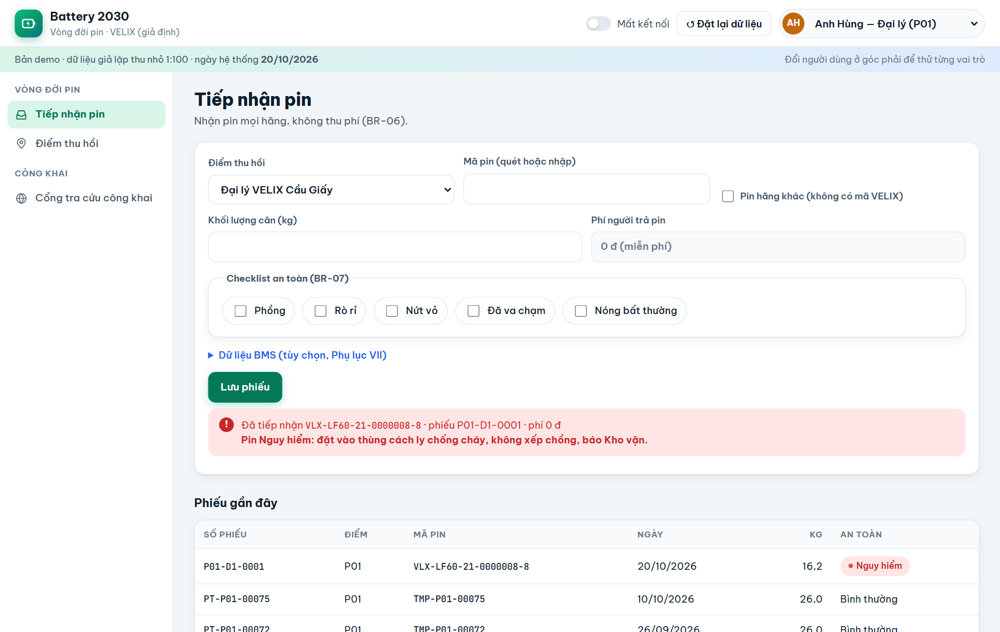

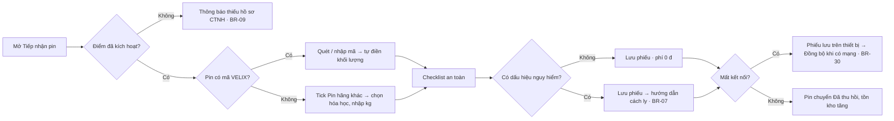

| Trạng thái | Hiển thị |
|---|---|
| Trống | Form sẵn sàng, điểm thu hồi chọn sẵn theo phạm vi người dùng |
| Lỗi | "Không tìm thấy mã pin…", "Pin đang ở trạng thái…", "Nhập khối lượng cân" |
| Ngoại tuyến | Nhãn "Đang ngoại tuyến"; nút "Đồng bộ N phiếu" |
| Thành công | Hộp xanh (bình thường) hoặc đỏ kèm hướng dẫn cách ly (nguy hiểm) |

## UF-02 Gom lô về trung tâm (Kho vận) — 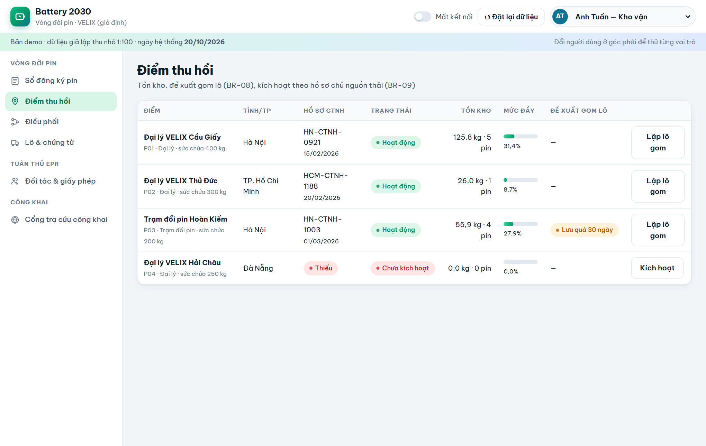

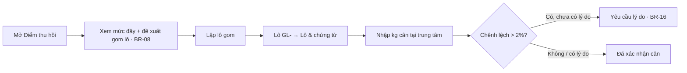

## UF-03 Đánh giá SoH (Kỹ thuật viên) — 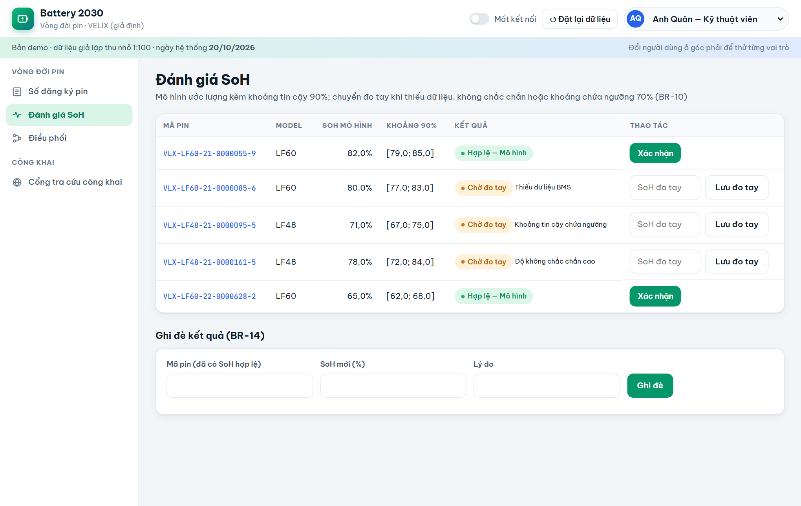

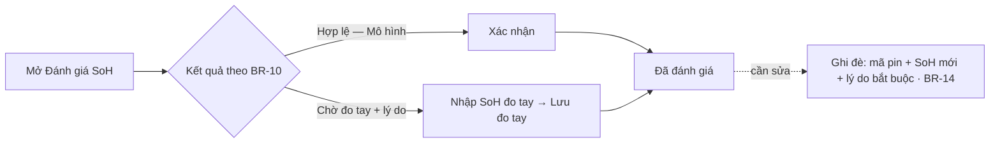

## UF-04 Điều phối (Kỹ thuật viên → Trưởng dịch vụ → Kho vận) — 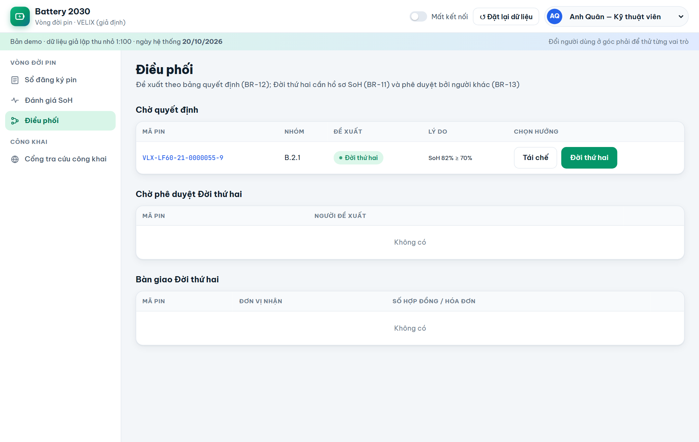

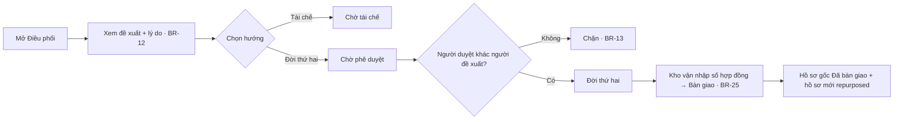

Nút trùng đề xuất của hệ thống được tô nổi; nút không được phép bị khóa kèm lý do khi rê chuột.

## UF-05 Bàn giao tái chế (Kho vận → Đơn vị tái chế) — 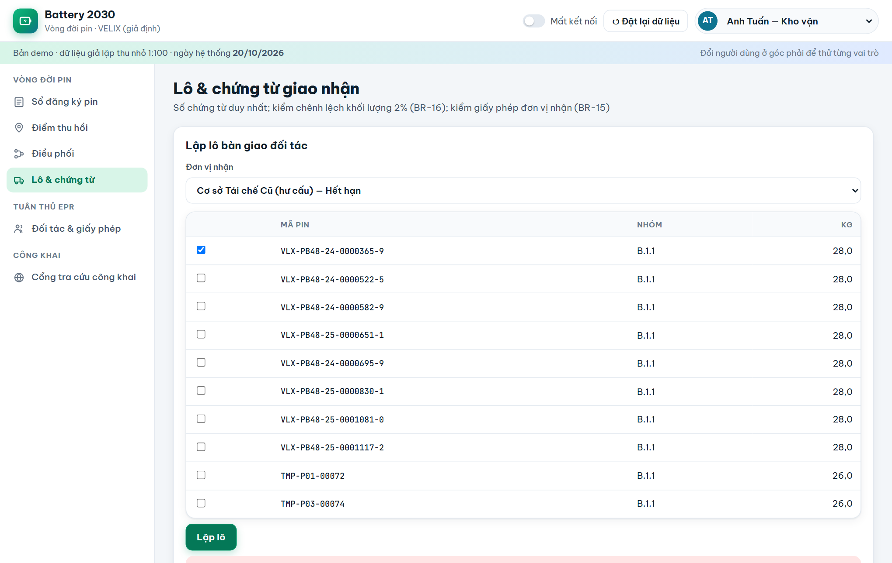

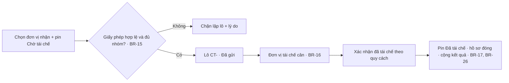

## UF-06 Lập báo cáo EPR (Cán bộ tuân thủ) — 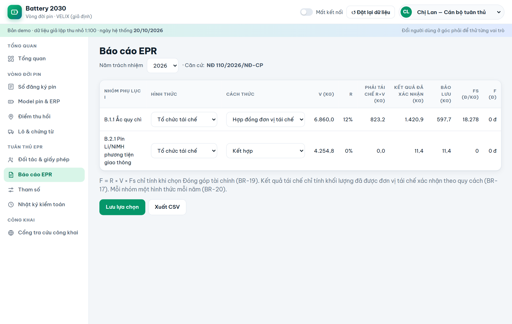

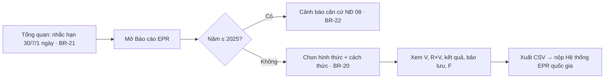

## Nguyên tắc trải nghiệm áp dụng

| Nguyên tắc | Cách làm trong prototype |
|---|---|
| Ít thao tác cho người dùng hiện trường | Tiếp nhận chỉ cần mã pin + khối lượng (tự điền) + một lần bấm (TC-071) |
| Hệ thống đề xuất, người quyết | Đề xuất điều phối kèm lý do; nút được đề xuất nổi bật |
| Chặn sai trước khi xảy ra | Nút bị khóa kèm lý do thay vì báo lỗi sau khi bấm |
| Trạng thái thấy ngay | Nhãn màu theo trạng thái; thẻ chỉ số và biểu đồ trên Tổng quan |
| Theo vai trò | Menu chỉ hiện chức năng của vai trò; phạm vi dữ liệu theo điểm/đối tác |
| Dùng được trên điện thoại | Màn tiếp nhận ở 360 px không cuộn ngang (TC-070) |
