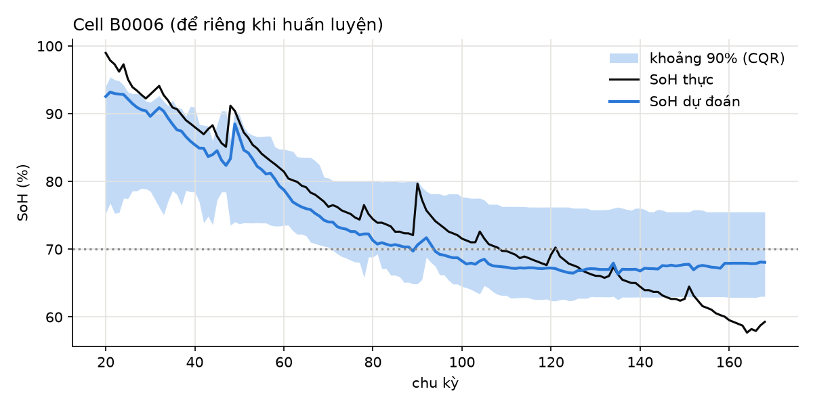

# S17 — Model card: Ước lượng SoH từ dữ liệu sạc

| Mục | Nội dung |
|---|---|
| Tên | SoH-Estimator-demo v0.1 |
| Mục đích | Ước lượng SoH (%) và khoảng tin cậy 90% của pin Li khi tiếp nhận, để quyết định đo tay hay không (BR-10) và đề xuất điều phối (BR-12) |
| Không dùng cho | Quyết định tự động ở MVP (DEC-11); pin ắc quy chì; pin bị hư hỏng vật lý (BR-07) |
| Dữ liệu | NASA PCoE Battery Data Set (SRC-016): 4 cell 18650, 2,0 Ah, 24°C, sạc CC-CV 1,5 A, xả CC 2 A; 576 chu kỳ xả có đủ đặc trưng |
| Mục tiêu dự đoán | SoH = dung lượng xả / 2,0 Ah × 100 |
| Đặc trưng | Số chu kỳ; thời gian sạc CC; thời gian sạc CV; nhiệt độ cao nhất khi sạc; điện áp đầu kỳ sạc; Re, Rct (lần đo trở kháng gần nhất) |
| Mô hình | Gradient Boosting (300 cây, sâu 3); khoảng tin cậy bằng Conformalized Quantile Regression |
| Kiểm định | Leave-one-battery-out: mỗi lần để riêng 1 cell làm tập kiểm thử |
| Mã nguồn | [soh_pipeline.py](soh_pipeline.py) · notebook [01](notebooks/01-eda.ipynb) [02](notebooks/02-features.ipynb) [03](notebooks/03-model.ipynb) [04](notebooks/04-evaluation.ipynb) |

## 1. Kết quả

| Chỉ số | Giá trị | Mục tiêu (S18) | Đạt |
|---|---|---|---|
| MAE | 2,53 điểm % | ≤ 3,0 (AIR-01) | Đạt |
| RMSE | 3,32 điểm % | — | — |
| MAE đường cơ sở: tuyến tính theo số chu kỳ | 4,22 | — | Mô hình tốt hơn 40% |
| MAE đường cơ sở: tuyến tính đủ đặc trưng | 2,52 | — | Ngang mô hình |
| Độ phủ khoảng 90% | 88,5% | ≥ 85% (AIR-02) | Đạt |
| Độ rộng khoảng trung bình | 14,4 điểm | ≤ 10 (PAR-06) để tự động | — |
| Tỷ lệ chuyển đo tay theo BR-10, ngưỡng 70% | 94,6% | ≤ 30% (AIR-04) | **Không đạt** |
| Độ chính xác của quyết định tự động, ngưỡng 70% | 87,1% (31 chu kỳ) | ≥ 97% (AIR-03) | **Không đạt** |
| Độ chính xác nếu bỏ bước người duyệt, ngưỡng 70% | 78,6% | — | Lý do cần BR-10 |
| Độ nhạy ngưỡng 80%: tỷ lệ đo tay / độ chính xác tự động | 81,8% / 100% | — | — |

MAE theo cell: B0005 1,51 · B0006 3,34 · B0007 1,75 · B0018 3,64.

## 2. Diễn giải

1. **Độ chính xác điểm đạt yêu cầu**, nhưng **khoảng tin cậy quá rộng** để tự động quyết định: chỉ có 4 cell, nên phần hiệu chỉnh conformal phải bao cả khác biệt giữa các cell.
2. **Dữ liệu NASA kết thúc quanh 70% SoH**, đúng vùng ngưỡng điều phối, nên phần lớn chu kỳ có khoảng tin cậy chứa ngưỡng.
3. **Mô hình dạng cây không ngoại suy:** khi SoH thực xuống dưới vùng đã học (B0006 sau chu kỳ 130), dự đoán đi ngang quanh 67–68%.
4. **Đường cơ sở tuyến tính đủ đặc trưng ngang mô hình phức tạp:** ưu tiên mô hình đơn giản, dễ giải thích khi triển khai thật.

## 3. Giới hạn và rủi ro

| Mã | Giới hạn | Hệ quả | Xử lý |
|---|---|---|---|
| L-1 | Cell 18650 NCA/LCO của phòng thí nghiệm, không phải pack LFP xe máy | Không chuyển thẳng sang pin VELIX | Huấn luyện lại trên dữ liệu pack VELIX (DEC-11) |
| L-2 | Một nhiệt độ (24°C), một chế độ tải | Sai lệch khi pin dùng ở khí hậu nóng | Thêm đặc trưng giờ ở nhiệt độ khắc nghiệt (Phụ lục VII) |
| L-3 | 4 cell | Khoảng tin cậy rộng | Đủ dữ liệu từ pilot trước khi bật tự động |
| L-4 | Không ngoại suy dưới vùng đã học | Đánh giá cao pin rất yếu | BR-10 bắt các trường hợp ngoài phân phối (khoảng rộng) |
| L-5 | Dùng dữ liệu đo trở kháng phòng thí nghiệm | BMS thương mại có thể không có Rct | Mô hình dự phòng không dùng Rct |

## 4. Đạo đức và trách nhiệm

- Mô hình chỉ **đề xuất**; người có thẩm quyền xác nhận (BR-13, BR-14).
- Mọi ghi đè có lý do và lưu vết.
- Không dùng dữ liệu cá nhân của người dùng xe.
