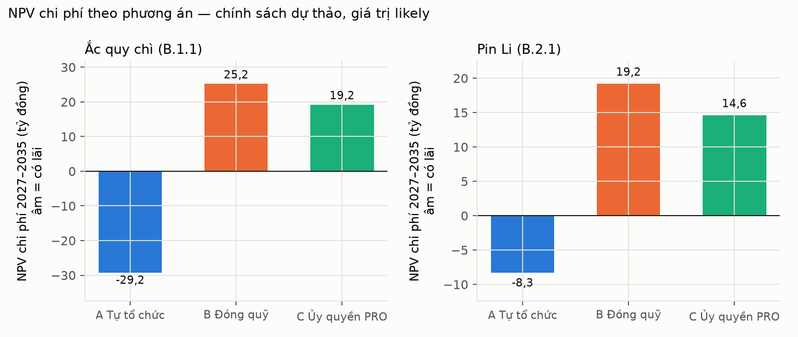
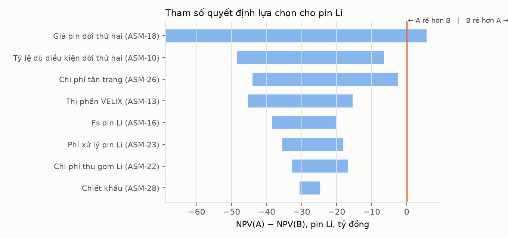

# S21 — Business case: VELIX nên thực hiện EPR pin theo cách nào?

> Mọi con số tiền là **ước lượng theo giả định có mức tin cậy Thấp** (ASM-13 – ASM-28). Tài liệu dùng để chọn hướng và biết điều kiện đổi hướng, không phải dự toán ngân sách. Mã nguồn: [model.py](model.py) · [report.py](report.py) · bảng tính [cost-model.xlsx](cost-model.xlsx).

## 1. Câu hỏi và phương án

RQ7: tự tổ chức tái chế, đóng quỹ EPR hay tham gia PRO — phương án nào hòa vốn, khi nào không đáng làm?

| Phương án | Nội dung | Căn cứ |
|---|---|---|
| **A — Tự tổ chức** | Nền tảng đầy đủ (MVP S12); thu hồi qua đại lý; hợp đồng đơn vị tái chế có phép; bán ắc quy chì phế liệu; bán pin LFP đời thứ hai | REQ-VN-02(a), REQ-VN-18 |
| **B — Đóng quỹ** | Nộp F = R × V × Fs vào Quỹ BVMT; nền tảng tối giản chỉ để tính V | REQ-VN-02(b), REQ-VN-24 |
| **C — Ủy quyền PRO** | Trả phí PRO; PRO tổ chức thu gom, tái chế; nền tảng tối giản | REQ-VN-18(c), REQ-VN-20 |

Mỗi nhóm Phụ lục I được chọn một hình thức riêng mỗi năm (BR-20), nên phân tích tách **ắc quy chì** và **pin Li**.

## 2. Đầu vào

| Nhóm | Thông số | Likely | Khoảng | Mã |
|---|---|---|---|---|
| Khối lượng | Thị phần VELIX × dự báo S9 (Cơ sở) | 5% | 3–8% | ASM-13 |
| Nghĩa vụ | R ắc quy chì | 12% | giữ nguyên | REQ-VN-15 |
| Nghĩa vụ | R pin Li: 3 kịch bản chính sách | 0% / 8% → 15% / 10% → 20% | — | ASM-17 |
| Đóng quỹ | Fs chì / Fs Li | 18.278 / 25.000 đ/kg | 15–22 nghìn / 15–40 nghìn | ASM-15, ASM-16 |
| Nền tảng | Đầy đủ / tối giản | 3,5 tỷ + 0,7 tỷ/năm / 0,8 tỷ + 0,2 tỷ/năm | — | ASM-21 |
| Thu gom | Li / chì | 9.000 / 4.000 đ/kg | 6–15 / 2–6 nghìn | ASM-22 |
| Xử lý pin Li | Phí ròng trả đơn vị tái chế | 12.000 đ/kg | 5–20 nghìn | ASM-23 |
| Ắc quy chì phế liệu | Giá bán | 10.000 đ/kg | 6–15 nghìn | ASM-24 |
| PRO | Phí so với số tiền đóng quỹ tương đương | 75% | 60–90% | ASM-25 |
| Đời thứ hai | Giá bán / chi phí tân trang | 1,0 triệu / 0,5 triệu đ/kWh | 0,6–1,5 / 0,3–0,8 triệu | ASM-18, ASM-26 |
| Đời thứ hai | Tỷ lệ đủ điều kiện | 35% | 20–50% | ASM-10 |
| Thu hồi | Tỷ lệ pin hết hạn của VELIX thu được (2027 → 2035) | 40% → 75% | 25–55% → 55–90% | ASM-27 |
| Tài chính | Chiết khấu | 10% | 8–12% | ASM-28 |

Khối lượng năm 2030 (Cơ sở): ắc quy chì đưa ra thị trường ≈1.739 tấn, hết hạn ≈1.648 tấn, phải tái chế ≈209 tấn; pin Li đưa ra thị trường ≈1.068 tấn, hết hạn ≈341 tấn, phải tái chế ≈85 tấn theo dự thảo ([yearly_likely.csv](outputs/yearly_likely.csv)).

## 3. Kết quả

NPV chi phí 2027–2035, triệu đồng, giá trị likely (âm = có lãi) — [npv_likely.csv](outputs/npv_likely.csv):

| Chính sách pin Li | Nhóm | A Tự tổ chức | B Đóng quỹ | C PRO | Rẻ nhất |
|---|---|---|---|---|---|
| Mọi kịch bản | Ắc quy chì | −29.239 | 25.204 | 19.202 | A |
| Hiện hành (0%) | Pin Li | −8.279 | 869 | 869 | A |
| Dự thảo (8% → 15%) | Pin Li | −8.279 | 19.187 | 14.607 | A |
| Cao (10% → 20%) | Pin Li | −8.279 | 24.895 | 18.888 | A |

Xác suất mỗi phương án rẻ nhất, 2.000 lượt Monte Carlo — [mc_best_option.csv](outputs/mc_best_option.csv):

| Chính sách pin Li | Nhóm | A | B | C |
|---|---|---|---|---|
| Mọi kịch bản | Ắc quy chì | 100% | 0% | 0% |
| Hiện hành (0%) | Pin Li | 60% | 40% | 0% |
| Dự thảo | Pin Li | 85,5% | 0% | 14,5% |
| Cao | Pin Li | 89,8% | 0% | 10,2% |

Khoảng P10–P90 của NPV(A) pin Li theo dự thảo: −33,4 đến +20,7 tỷ đồng — rộng, đổi dấu ([mc_npv_quantiles.csv](outputs/mc_npv_quantiles.csv)).

**Hoàn vốn:** so với B, phương án A (cả hai nhóm, dự thảo, likely) có dòng tiền tiết kiệm dương ngay năm 2027 (3,7 tỷ đồng) vì nghĩa vụ ắc quy chì đã có và phế liệu chì có giá trị ([payback_A_vs_B.csv](outputs/payback_A_vs_B.csv)).

## 4. Điều gì quyết định kết quả với pin Li

Ba tham số lớn nhất đều thuộc **thị trường đời thứ hai** (giá bán, tỷ lệ đủ điều kiện, chi phí tân trang). Thị phần và Fs xếp sau.

| Điểm hòa vốn (pin Li, các tham số khác ở likely) | Giá trị | Nguồn |
|---|---|---|
| Giá pin đời thứ hai để A = B, chính sách dự thảo | ≈ 669 nghìn đ/kWh | [breakeven.json](outputs/breakeven.json) |
| Giá pin đời thứ hai để A = C, chính sách dự thảo | ≈ 724 nghìn đ/kWh | — |
| Giá pin đời thứ hai để A = B, chính sách hiện hành (0%) | ≈ 890 nghìn đ/kWh | — |
| Giá ắc quy chì phế liệu để A = B | ≈ 350 đ/kg (xa dưới mọi mức hợp lý) | — |

## 5. Ma trận quyết định có trọng số

Điểm 1–5 (5 tốt nhất). Chi phí lấy từ §3; các tiêu chí khác là đánh giá định tính của BA.

| Tiêu chí | Trọng số | A | B | C | Ghi chú |
|---|---|---|---|---|---|
| Chi phí NPV (likely) | 35% | 5 | 1 | 2 | §3 |
| Rủi ro tuân thủ | 20% | 3 | 5 | 4 | B ít bước nhất; A phụ thuộc chứng từ (REQ-VN-21) |
| Dữ liệu và kiểm soát pin | 20% | 5 | 1 | 2 | Chỉ A có dữ liệu từng pin (đo được OBJ-3) |
| Thương hiệu / ESG | 15% | 5 | 2 | 3 | Thu hồi tại đại lý là điểm chạm khách hàng |
| Độ phức tạp vận hành | 10% | 1 | 5 | 4 | A cần đào tạo đại lý, logistics hàng nguy hại |
| **Tổng** | 100% | **4,20** | **2,35** | **2,75** | |

## 6. Khuyến nghị

1. **Ắc quy chì — chọn A ngay từ năm trách nhiệm 2026:** đăng ký "Tổ chức tái chế", cách thức "Hợp đồng đơn vị tái chế" có phép nhóm B.1.1. Thu hồi qua đại lý, bán phế liệu chì. Phần thu hồi vượt R × V được bảo lưu (REQ-VN-13).
2. **Pin Li — xây nền tảng và mạng thu hồi ngay, nhưng quyết định hình thức 2029–2031 trước 30/6/2028 (OBJ-5):** năm 2026–2028 R = 0 nên không phát sinh tiền phải nộp. Dùng 2027–2028 để thu dữ liệu giá đời thứ hai thật và tỷ lệ thu hồi thật.
3. **Quy tắc đổi hướng cho pin Li:** nếu giá bán pin đời thứ hai đo được trong thí điểm dưới **~0,7 triệu đ/kWh**, hoặc tỷ lệ đủ điều kiện dưới 20%, chuyển pin Li sang **C (PRO)** cho chu kỳ 2029–2031; vẫn giữ nền tảng cho ắc quy chì.
4. **Đầu tư nền tảng theo giai đoạn:** MVP đủ cho ắc quy chì (hoàn vốn từ năm đầu theo likely); hạng mục đời thứ hai (US-17) và mô hình SoH tự động (DEC-11) chỉ mở khi có dữ liệu thí điểm.

## 7. Khi nào KHÔNG đáng làm phương án A

| Điều kiện | Hệ quả | Theo dõi bằng |
|---|---|---|
| Giá pin đời thứ hai < ~0,67 triệu đ/kWh (dự thảo) hoặc < ~0,89 triệu (chính sách 0%) | A cho pin Li đắt hơn B/C | KPI giá bán đời thứ hai |
| VELIX phải trả tiền cho khách để cạnh tranh với người thu mua ắc quy chì, mức trả gần bằng giá phế liệu trừ chi phí thu gom (~6.000 đ/kg) | Lợi thế của A với ắc quy chì biến mất | Tỷ lệ thu hồi ắc quy chì thực tế |
| Không có đơn vị tái chế pin Li có phép trong nước và phí xuất khẩu xử lý > 20.000 đ/kg | Chi phí pin Li không đủ điều kiện đời thứ hai tăng | Báo giá đơn vị tái chế |
| Dự thảo không được ban hành, R pin Li giữ 0% sau 2029 | Xác suất A tốt nhất cho pin Li chỉ còn 60% | Theo dõi văn bản (RSK-01) |
| Tỷ lệ thu hồi thực tế ở thí điểm < 25% | Doanh thu đời thứ hai không đủ bù đầu tư | KPI thu gom (BR-23) |

## 8. KPI và OKR

| Objective | Key result | Mốc |
|---|---|---|
| Tuân thủ EPR không phạt | Hồ sơ năm 2026 nộp trước 01/4/2027; F hoặc kết quả tái chế ≥ R × V | 31/3/2027 |
| Đo được dòng pin | 100% pin bán ra có mã; tỷ lệ thu gom LMT báo cáo hằng tháng | 06/2027 |
| Kiểm chứng kinh tế đời thứ hai | ≥ 200 pin LFP đời thứ hai bán qua thí điểm, có giá bán thực | 06/2028 |
| Chọn hình thức cho chu kỳ 2029–2031 | Quyết định có số liệu thí điểm, trình Ban điều hành | 30/6/2028 |

## 9. Lộ trình triển khai

| Giai đoạn | Thời gian | Nội dung | Điều kiện chuyển giai đoạn |
|---|---|---|---|
| 0 Chuẩn bị | Q4/2026 | Hợp đồng đơn vị tái chế chì; hồ sơ chủ nguồn thải cho 3 điểm thí điểm | Có giấy phép đối tác hợp lệ |
| 1 MVP | Q1/2027 | Sổ đăng ký, tiếp nhận, chứng từ, báo cáo EPR 2026 | Nộp hồ sơ trước 01/4/2027 |
| 2 Mở rộng | Q2–Q4/2027 | Toàn mạng đại lý; SoH chế độ song song | Tỷ lệ thu hồi ≥ 25% |
| 3 Đời thứ hai | 2028 | Bàn giao đời thứ hai, đo giá bán thực; quyết định hình thức pin Li | Đạt KR "≥ 200 pin" |
| 4 Ổn định | 2029+ | Theo hình thức đã chọn; bật SoH tự động khi đạt AIR-03/04 | DEC-11 |
