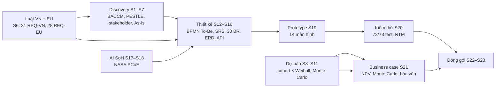

# Battery 2030 — Nền tảng vòng đời pin xe điện và trách nhiệm thu hồi (EPR) tại Việt Nam

**Dự án Business Analysis:** từ văn bản luật → dự báo pin hết hạn → đặc tả → prototype kiểm thử tự động → business case.
Khách hàng giả định: **VELIX** (hãng xe máy điện hư cấu). Dữ liệu doanh nghiệp là giả lập. Ngày: 20/10/2026.

**[Case study](https://taint7684.github.io/battery-2030-ba/)** · **[Dashboard dự báo](https://taint7684.github.io/battery-2030-ba/forecast.html)** · **[Prototype](https://taint7684.github.io/battery-2030-ba/prototype/)** · **[Tóm tắt điều hành](08-package/S22-executive-summary.md)**


## Năm phát hiện

1. **Mốc 2029 của NĐ 110/2026 trùng với năm pin Li hết hạn vượt 10 nghìn tấn/năm.** Pin Li hết hạn ≈15 nghìn tấn năm 2030 và ≈71 nghìn tấn năm 2035 (kịch bản Cơ sở, trung vị).
2. **Ắc quy chì là bài toán hiện tại:** ≈33 nghìn tấn/năm năm 2030, lớn hơn pin Li đến 2033; nghĩa vụ 12% đã có từ năm trách nhiệm 2026.
3. **≈70% pin hết hạn năm 2030 đi kênh không chứng từ** (ước lượng theo khoảng). Đời thứ hai bị chặn bởi thu hồi, không phải bởi công nghệ.
4. **Việt Nam đo khối lượng đã tái chế, EU đo tỷ lệ thu gom:** 6 khoảng trống ⛔ quyết định thiết kế nền tảng.
5. **AI có kiểm soát:** mô hình SoH đủ chính xác (MAE 2,53 điểm) nhưng chưa đủ chắc để tự quyết: quy tắc BR-10 chuyển 94,6% trường hợp sang đo tay, nên MVP chạy mô hình song song (DEC-11).

## Bản đồ dự án



## Sản phẩm

| Mã | Sản phẩm | Tệp |
|---|---|---|
| S1–S5 | Charter · BACCM · PESTLE/SWOT · stakeholder/RACI · persona | [01-discovery](01-discovery) |
| S7 | Quy trình As-Is (BPMN) · khai thác yêu cầu · nguyên nhân gốc · context diagram | [S7-as-is](01-discovery/S7-as-is/as-is.md) |
| S6 | Ma trận tuân thủ VN × EU · trích nguyên văn · ánh xạ Battery Passport | [02-regulatory](02-regulatory/README.md) |
| S8–S11 | Dữ liệu · dự báo · dòng vật chất · phản biện | [03-forecast](03-forecast/S9-forecast-results.md) |
| S12–S16 | Vision & Scope · BPMN To-Be · SRS · dữ liệu · backlog | [04-solution](04-solution/S14-srs.md) |
| S17–S18 | Model card SoH · yêu cầu AI (SRS §7) | [05-ai-soh](05-ai-soh/S17-model-card.md) |
| S19 | Prototype click được | [docs/prototype](docs/prototype/index.html) · [ảnh màn hình](04-solution/screens) |
| S20 | Kế hoạch kiểm thử · 73 test case · RTM · UAT | [06-test](06-test/S20-test-plan.md) |
| S21 | Business case | [07-business-case](07-business-case/S21-business-case.md) |
| S22–S23 | Tóm tắt điều hành · case study · slide | [08-package](08-package) |
| — | Quản lý: nguồn, giả định, quyết định, rủi ro, thuật ngữ | [00-management](00-management) |

## Chạy lại

```bash
py -m venv .venv && .venv/Scripts/python -m pip install -r requirements.txt
.venv/Scripts/python tools/fetch_sources.py              # tải nguồn gốc (không commit)
.venv/Scripts/python tools/build_all.py                  # chạy lại mọi bước và kiểm tra
```

`build_all.py` chạy theo thứ tự: dự báo (1.000 lượt Monte Carlo) → độ nhạy → biểu đồ → Sankey → dữ liệu giả lập → mô hình SoH → business case → test prototype (Playwright) → sinh SRS phụ lục, backlog, RTM → trang Pages → `tools/check_all.py`. Bước Playwright cần `NODE_PATH` trỏ tới thư mục `node_modules` có gói `playwright`.

## Nguyên tắc chất lượng

Mọi số liệu có mã nguồn `SRC-xxx` hoặc mã giả định `ASM-xxx`; yêu cầu từ luật trích nguyên văn kèm điều khoản; ước lượng trình bày theo khoảng; mọi yêu cầu truy được từ luật/nhu cầu đến test case, kiểm bằng `tools/check_all.py` (54 mục kiểm).

## Giấy phép

Tài liệu và dữ liệu do dự án tạo: CC BY 4.0. Mã nguồn: MIT. Dữ liệu bên thứ ba giữ giấy phép gốc: Battery Pass Data Model (CC BY 4.0), NASA PCoE (dữ liệu công khai), văn bản pháp luật VN và EU, ICCT và báo chí chỉ trích dẫn ngắn có ghi nguồn. Xem [source-log.csv](00-management/source-log.csv).

**Miễn trừ:** đây là phân tích nghiệp vụ phục vụ thiết kế hệ thống, không phải tư vấn pháp lý.
